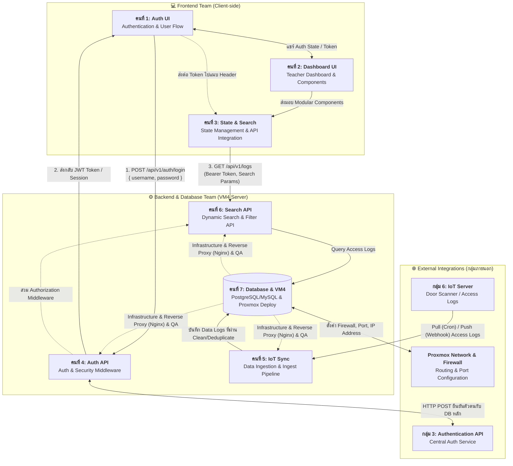

# 📌 Group 4: Web Application (Access Log & Teacher Dashboard)

เอกสารสรุปสถาปัตยกรรมระบบ, โครงสร้างการเชื่อมต่อภายในทีม (Internal Connections), และการเชื่อมต่อกับระบบภายนอก (External Integrations) สำหรับโปรเจกต์ **Group 4 - Web Application**

---

## 📑 สารบัญ
1. [ภาพรวมของระบบและบทบาทหน้าที่ (Team Overview)](#-ภาพรวมของระบบและบทบาทหน้าที่-team-overview)
2. [แผนผังการเชื่อมต่อภายในและภายนอก (Architecture & Connection Diagram)](#-แผนผังการเชื่อมต่อภายในและภายนอก-architecture--connection-diagram)
   - [2.1 แผนภาพ Mermaid Diagram](#21-แผนภาพ-mermaid-diagram)
   - [2.2 แผนผัง ASCII Diagram](#22-แผนผัง-ascii-diagram)
3. [รายละเอียดการเชื่อมต่อและหน้าที่ของสมาชิก (Member Roles & Connections)](#-รายละเอียดการเชื่อมต่อและหน้าที่ของสมาชิก-member-roles--connections)
   - [คนที่ 1: Frontend Developer (Authentication & User Flow)](#คนที่-1-frontend-developer-authentication--user-flow)
   - [คนที่ 2: Frontend Developer (Teacher Dashboard & UI Components)](#คนที่-2-frontend-developer-teacher-dashboard--ui-components)
   - [คนที่ 3: Frontend Developer (State Management & Search Integration)](#คนที่-3-frontend-developer-state-management--search-integration)
   - [คนที่ 4: Backend Developer (Authentication & Security API)](#คนที่-4-backend-developer-authentication--security-api)
   - [คนที่ 5: Backend Developer (Data Ingestion & IoT Sync)](#คนที่-5-backend-developer-data-ingestion--iot-sync)
   - [คนที่ 6: Backend Developer (Search & Filter API)](#คนที่-6-backend-developer-search--filter-api)
   - [คนที่ 7: Database Administrator, DevOps & Tester](#คนที่-7-database-administrator-devops--tester)
4. [สรุปจุดเชื่อมต่อกับกลุ่มภายนอก (External Integration Map)](#-สรุปจุดเชื่อมต่อกับกลุ่มภายนอก-external-integration-map)
5. [สรุปข้อมูลทางเทคนิคและ API Specification (Technical Summary)](#-สรุปข้อมูลทางเทคนิคและ-api-specification-technical-summary)

---

## 👥 ภาพรวมของระบบและบทบาทหน้าที่ (Team Overview)

| ลำดับ | บทบาท (Role) | สมาชิก / ตำแหน่ง | หน้าที่หลัก (Core Responsibilities) | จุดเชื่อมต่อหลัก |
| :---: | :--- | :--- | :--- | :--- |
| **คนที่ 1** | Frontend | Authentication & User Flow | พัฒนาหน้า Login, Form Validation, Route Guard, จัดเก็บ Token | คนที่ 2, 3, 4 |
| **คนที่ 2** | Frontend | Dashboard & UI Components | ออกแบบ Dashboard อาจารย์, Component ตาราง, ตัวกรอง, Pagination | คนที่ 3 |
| **คนที่ 3** | Frontend | State Management & Integration | เชื่อมโยง Data State, ต่อ API กับ Backend, จัดการ Loading/Error | คนที่ 1, 2, 6 |
| **คนที่ 4** | Backend | Authentication & Security API | ตรวจสอบ Auth กับกลุ่ม 3, ออก JWT Token, ทำ Auth Middleware | คนที่ 1, 3, 6, **กลุ่ม 3** |
| **คนที่ 5** | Backend | Data Ingestion & IoT Sync | Pipeline ดึง/รับ Logs จาก IoT กลุ่ม 6, คัดกรองข้อมูลซ้ำ, บันทึก DB | คนที่ 7, **กลุ่ม 6** |
| **คนที่ 6** | Backend | Search & Filter API | ทำ Dynamic Query, Filter วันที่/คำค้นหา, Pagination บน Database | คนที่ 3, 4, 7 |
| **คนที่ 7** | Infra/DB | DBA, DevOps & QA Tester | ออกแบบ Schema/Index, ติดตั้ง Nginx/VM4 บน Proxmox, ทดสอบ E2E | คนที่ 1-6, **กลุ่ม 3, 6 (Network)** |

---

## 🗺️ แผนผังการเชื่อมต่อภายในและภายนอก (Architecture & Connection Diagram)

### 2.1 แผนภาพ Mermaid Diagram



---

### 2.2 แผนผัง ASCII Diagram

```text
[คนที่ 1: Auth UI] <─────เชื่อมต่อข้อมูล Token/State─────> [คนที่ 2: Dashboard UI]
        │                                                     │
        │                                            สร้าง Component ให้
        ▼                                                     ▼
[คนที่ 4: Auth API]                                  [คนที่ 3: State & Search]
        │                                                     │
        │                                           ดึง API ไปผูกกับ UI
        │                                                     ▼
        ├──────────── ยิง Query หา DB ──────────────> [คนที่ 6: Search API]
        │                                                     │
        ▼                                                     ▼
[คนที่ 7: DB & VM4] <────── Sync ข้อมูลบันทึกลง DB ────── [คนที่ 5: IoT Sync]
```

---

## 🔍 รายละเอียดการเชื่อมต่อและหน้าที่ของสมาชิก (Member Roles & Connections)

### คนที่ 1: Frontend Developer (Authentication & User Flow)
* **บทบาท:** ดูแลระบบยืนยันตัวตนฝั่งผู้ใช้งาน (Client-side Authentication)
* **การเชื่อมต่อภายในกลุ่ม:**
  * **เชื่อมต่อกับ คนที่ 4 (Backend Auth):** ส่งข้อมูล `{ username, password }` ไปยัง Endpoint `POST /api/v1/auth/login` และรอรับ JWT Token / Session กลับมา
  * **เชื่อมต่อกับ คนที่ 2 & 3 (Frontend Team):** ส่งต่อ Auth State (เช่น สถานะการ Login, User Role ของอาจารย์) และ Token เพื่อให้คนที่ 3 นำไปแนบใน Header (`Authorization: Bearer <token>`) ของ Request อื่นๆ
* **การทำงานร่วมกับกลุ่มภายนอก:**
  * *ไม่มีการเชื่อมต่อโดยตรง* (ส่งผ่าน คนที่ 4 เพื่อไปคุยกับกลุ่ม 3)
* **รายละเอียดงานที่รับผิดชอบ:**
  1. พัฒนาหน้า Login Interface ที่สวยงามและตอบสนองตามสเปก
  2. จัดทำ Client-side Form Validation
  3. จัดเก็บ Token ลงใน Browser Storage อย่างปลอดภัย (เช่น HttpOnly Cookie หรือ In-Memory/Secure LocalStorage)
  4. จัดทำ Route Guard ป้องกันไม่ให้ผู้ใช้ที่ไม่ผ่านการยืนยันตัวตนเข้าสู่หน้า Dashboard

---

### คนที่ 2: Frontend Developer (Teacher Dashboard & UI Components)
* **บทบาท:** ออกแบบและพัฒนาโครงสร้าง UI หน้า Dashboard สำหรับอาจารย์
* **การเชื่อมต่อภายในกลุ่ม:**
  * **เชื่อมต่อกับ คนที่ 3 (Frontend State/API):** ส่งมอบ UI Components ที่พัฒนาเสร็จแล้ว (ตาราง, Search Box, Filter Date, Pagination) ให้คนที่ 3 นำไปผูกกับ API ดึงข้อมูล
* **การทำงานร่วมกับกลุ่มภายนอก:**
  * *ไม่มีการเชื่อมต่อโดยตรง*
* **รายละเอียดงานที่รับผิดชอบ:**
  1. ออกแบบหน้า Teacher Dashboard สำหรับตรวจสอบประวัติการเข้า-ออกห้องเรียน
  2. พัฒนาตารางแสดงผล Access Logs ที่รองรับข้อมูลจำนวนมาก
  3. สร้างส่วนติดต่อผู้ใช้สำหรับตัวกรอง (Search & Filter Interfaces) เช่น ค้นหาตามชื่อ, เลือกช่วงวันเวลา, Dropdown สถานะ
  4. พัฒนาคอมโพเนนต์ในรูปแบบ **Modular Component** เพื่อให้สวมใส่ Data State และ Logic ได้ง่าย

---

### คนที่ 3: Frontend Developer (State Management & Search Integration)
* **บทบาท:** จัดการ Data State และเชื่อมโยง UI เข้ากับ Backend API
* **การเชื่อมต่อภายในกลุ่ม:**
  * **เชื่อมต่อกับ คนที่ 1 (Frontend Auth):** ดึง Token/Session มาแนบใน Header (`Authorization: Bearer <token>`) เมื่อต้องส่ง Request ดึงข้อมูล
  * **เชื่อมต่อกับ คนที่ 2 (Frontend UI):** นำ UI Components ที่คนที่ 2 สร้างไว้มาผูกเข้ากับ Data State ของแอปพลิเคชัน
  * **เชื่อมต่อกับ คนที่ 6 (Backend Search API):** ยิง Request ไปยัง `GET /api/v1/logs` พร้อมแนบ Query Parameters เช่น `keyword`, `date`, `page`, `limit` เพื่อนำข้อมูลมาเรนเดอร์ลงในตาราง
* **การทำงานร่วมกับกลุ่มภายนอก:**
  * *ไม่มีการเชื่อมต่อโดยตรง*
* **รายละเอียดงานที่รับผิดชอบ:**
  1. จัดการ Application State (State Management) สำหรับการค้นหาและการกรอง
  2. รับ Input ค่าจากตัวกรอง แล้วส่ง Request ไปยัง API ของคนที่ 6
  3. จัดการสถานะการแสดงผลต่างๆ บนหน้าเว็บ: **Loading State**, **Empty State**, และ **Error Handling / Notification**

---

### คนที่ 4: Backend Developer (Authentication & Security API)
* **บทบาท:** รับผิดชอบระบบยืนยันตัวตน, จัดการสิทธิ์การเข้าถึง และเป็น Gateway สื่อสารกับกลุ่ม 3
* **การเชื่อมต่อภายในกลุ่ม:**
  * **เชื่อมต่อกับ คนที่ 1 (Frontend Auth):** พัฒนา API Endpoint รับ Request Login จากคนที่ 1 และออก JWT Token กลับไปให้
  * **เชื่อมต่อกับ คนที่ 3 & 6 (Backend Security):** พัฒนา Authorization Middleware ให้คนที่ 6 นำไปใช้ดักจับ Request จากคนที่ 3 เพื่อตรวจสอบความถูกต้องของ Token และสิทธิ์ของอาจารย์ (Role-Based Access Control)
* **การทำงานร่วมกับกลุ่มภายนอก:**
  * **เชื่อมต่อกับ กลุ่ม 3 (Authentication API):** เมื่อได้รับ Username/Password จากคนที่ 1 จะต้องส่ง HTTP POST Request ไปยัง API ของกลุ่ม 3 เพื่อให้กลุ่ม 3 ตรวจสอบยืนยันตัวตนกับฐานข้อมูลกลาง
* **รายละเอียดงานที่รับผิดชอบ:**
  1. ทำหน้าที่เป็นตัวกลางตรวจสอบความถูกต้องของรหัสผ่านร่วมกับกลุ่ม 3
  2. ออกและตรวจสอบความถูกต้องของ JWT Token (Signing & Verification)
  3. เขียน Middleware จำกัดสิทธิ์ (RBAC) เพื่อปกป้อง Endpoint ภายในระบบ

---

### คนที่ 5: Backend Developer (Data Ingestion & IoT Sync)
* **บทบาท:** รับ-ดึงข้อมูลบันทึกการเข้าห้องจาก IoT Server และทำ Data Pipeline
* **การเชื่อมต่อภายในกลุ่ม:**
  * **เชื่อมต่อกับ คนที่ 7 (DBA & DevOps):** ร่วมกันออกแบบและนำข้อมูล Access Logs ที่ประมวลผลแล้วบันทึกลง Database Schema ของกลุ่ม 4
* **การทำงานร่วมกับกลุ่มภายนอก:**
  * **เชื่อมต่อกับ กลุ่ม 6 (IoT Server):** ทำการดึงข้อมูล (Pull ผ่าน Cron Job / Scheduled Task) หรือรับข้อมูล (Push ผ่าน Webhook API) ประวัติการเข้า-ออกห้องเรียน (Access Logs) ที่สแกนจากประตู
* **รายละเอียดงานที่รับผิดชอบ:**
  1. สร้าง Data Ingestion Pipeline เชื่อมต่อไปยัง IoT Server ของกลุ่ม 6
  2. แปลงโครงสร้างข้อมูล (Data Transformation) ให้อยู่ในรูปแบบที่ระบบของกลุ่ม 4 รองรับ
  3. กรองข้อมูลซ้ำซ้อน (Data Deduplication) และตรวจสอบความถูกต้องของข้อมูล
  4. บันทึกข้อมูลลงฐานข้อมูล พร้อมจัดทำระบบ Log Monitoring

---

### คนที่ 6: Backend Developer (Search & Filter API)
* **บทบาท:** พัฒนา REST API สำหรับการค้นหา กรอง และแบ่งหน้าข้อมูล Access Logs
* **การเชื่อมต่อภายในกลุ่ม:**
  * **เชื่อมต่อกับ คนที่ 4 (Backend Security):** นำ Middleware ของคนที่ 4 มาติดตั้งที่ API Endpoint เพื่อป้องกันการเข้าถึงโดยไม่ได้รับอนุญาต
  * **เชื่อมต่อกับ คนที่ 3 (Frontend Integration):** ร่วมกำหนด API Contract และพัฒนา Endpoint `GET /api/v1/logs` ให้คนที่ 3 ใช้งาน
  * **เชื่อมต่อกับ คนที่ 7 (DBA & DevOps):** เขียนคำสั่ง SQL Query ที่มีประสิทธิภาพเพื่อค้นหาข้อมูลจาก Database
* **การทำงานร่วมกับกลุ่มภายนอก:**
  * *ไม่มีการเชื่อมต่อโดยตรง*
* **รายละเอียดงานที่รับผิดชอบ:**
  1. พัฒนา Dynamic Query ค้นหาและกรองข้อมูลย้อนหลังตามเงื่อนไข (คำค้นหา, ชื่อ-รหัส, ช่วงเวลา, สถานะ)
  2. ทำระบบ Server-side Pagination เพื่อเพิ่มความเร็วและลดภาระการส่งข้อมูลปริมาณมาก
  3. จัดเตรียม API Documentation / Contract ให้ฝั่ง Frontend ใช้งานได้ตรงกัน

---

### คนที่ 7: Database Administrator, DevOps & Tester
* **บทบาท:** จัดการฐานข้อมูล, ดูแล Server/Infrastructure บน VM4 และทดสอบระบบ End-to-End
* **การเชื่อมต่อภายในกลุ่ม:**
  * **เชื่อมต่อกับ คนที่ 4, 5, 6 (Backend Team):** ออกแบบ Database Schema และสร้าง Indexing ให้เหมาะสมกับการบันทึกของคนที่ 5 และการ Query ของคนที่ 6
  * **เชื่อมต่อกับ คนที่ 1-6 (ทุกคนในทีม):** นำ Web Application (Frontend & Backend) และ Database ไปติดตั้งและ Deploy บน VM4 (Proxmox)
  * **เชื่อมต่อกับทุกคนในทีมเพื่อทำ QA:** วางแผนและทำการทดสอบระบบแบบ End-to-End (E2E Testing) ตั้งแต่การ Login, การ Sync ข้อมูล ไปจนถึงการแสดงผลบน Dashboard
* **การทำงานร่วมกับกลุ่มภายนอก:**
  * **เชื่อมต่อกับ กลุ่ม 3 และ กลุ่ม 6:** ประสานงานด้านระบบเครือข่าย (IP Address, Port, Firewall Rules) บน Proxmox เพื่อให้ VM4 สื่อสารกับเครื่อง Server ของกลุ่ม 3 และกลุ่ม 6 ได้อย่างราบรื่น
* **รายละเอียดงานที่รับผิดชอบ:**
  1. ออกแบบและจัดการฐานข้อมูล (Database Schema, Normalization, Data Types)
  2. ปรับแต่ง Database Indexing เพื่อเพิ่มความเร็วในการ Query
  3. ติดตั้งและดูแล Server บน VM4 (Proxmox), ทำ Reverse Proxy ด้วย Nginx, ตั้งค่า SSL/TLS (ถ้ามี)
  4. ทำการทดสอบระบบ (Quality Assurance) และตรวจสอบความถูกต้องของข้อมูลแบบครบวงจร

---

## 🌐 สรุปจุดเชื่อมต่อกับกลุ่มภายนอก (External Integration Map)

> [!IMPORTANT]
> เพื่อความเป็นระเบียบและปลอดภัยของระบบ การสื่อสารกับระบบภายนอกจะทำผ่านตัวแทน (Single Point of Contact) ในแต่ละด้านดังนี้:

```text
┌─────────────────────────────────┐
│        กลุ่ม 3 (Auth API)       │
└────────────────┬────────────────┘
                 │ (1) ยืนยันตัวตน (POST Username/Password)
                 ▼
     ┌───────────────────────┐
     │ คนที่ 4 (Backend Auth) │
     └───────────────────────┘

┌─────────────────────────────────┐
│       กลุ่ม 6 (IoT Server)      │
└────────────────┬────────────────┘
                 │ (2) ประวัติการเข้า-ออก (Pull / Push Logs)
                 ▼
     ┌───────────────────────┐
     │ คนที่ 5 (Backend Sync) │
     └───────────────────────┘

┌─────────────────────────────────┐
│    เครือข่าย VM / Proxmox       │
└────────────────┬────────────────┘
                 │ (3) จัดการ Firewall, IP Address, Port Communication
                 ▼
     ┌───────────────────────┐
     │  คนที่ 7 (DevOps/DBA)  │
     └───────────────────────┘
```

1. **กลุ่ม 3 (Authentication API):**
   * **ผู้ประสานงาน:** **คนที่ 4 (Backend Auth)**
   * **ลักษณะการเชื่อมต่อ:** ส่ง Username & Password ผ่าน HTTP POST Request ไปยืนยันตัวตนกับฐานข้อมูลหลักของกลุ่ม 3 แล้วรับผลการตรวจสอบกลับมาออก Token ให้ Frontend
2. **กลุ่ม 6 (IoT Server):**
   * **ผู้ประสานงาน:** **คนที่ 5 (Backend Sync)**
   * **ลักษณะการเชื่อมต่อ:** เชื่อมต่อเพื่อรับข้อมูลประวัติการสแกนบัตร/ประตูเข้าห้องเรียน (Access Logs) ผ่าน Webhook หรือ Polling/Cron Job นำข้อมูลมา Clean และบันทึกลง Database ของกลุ่ม 4
3. **เครือข่าย VM / Infrastructure (Proxmox Network):**
   * **ผู้ประสานงาน:** **คนที่ 7 (DevOps)**
   * **ลักษณะการเชื่อมต่อ:** กำหนดค่าเครือข่าย, IP Routing, Firewall และ Port บนระบบ Proxmox เพื่อเปิดช่องทางการสื่อสารระหว่าง VM4 ของกลุ่ม 4 กับ VM ของกลุ่ม 3 และกลุ่ม 6

---

## 🛠️ สรุปข้อมูลทางเทคนิคและ API Specification (Technical Summary)

### API Endpoints ภายในระบบกลุ่ม 4

| Method | Endpoint | ผู้สร้าง (Provider) | ผู้เรียกใช้ (Consumer) | หน้าที่ | Header / Parameters |
| :--- | :--- | :--- | :--- | :--- | :--- |
| `POST` | `/api/v1/auth/login` | คนที่ 4 | คนที่ 1 | รับข้อมูลเข้าสู่ระบบและคืน JWT Token | **Body:** `{ "username": "...", "password": "..." }` |
| `GET` | `/api/v1/logs` | คนที่ 6 | คนที่ 3 | ดึงข้อมูล Access Logs สำหรับ Dashboard | **Header:** `Authorization: Bearer <token>`<br/>**Query:** `keyword`, `date`, `page`, `limit` |
| `POST` / `PULL` | Data Ingestion Pipeline | คนที่ 5 | กลุ่ม 6 | รับหรือดึง Access Logs จาก IoT Server | JSON Data Schema ของ Access Logs |

---

> จัดทำขึ้นสำหรับการประสานงานและการส่งมอบงานในโครงการ **Group 4 Web Application**
