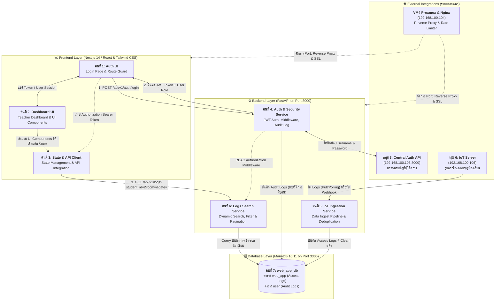

# 🚪 Door Authentication System — กลุ่ม CE04 (Group 4)
## 📌 Web Application: Access Log & Teacher Dashboard

> **โครงการ:** Door Authentication System (Security Mini-project)  
> **กลุ่ม:** Group 4 (CE04) — Web Application (ระบบสืบค้นประวัติการเข้า-ออกห้องเรียนและแดชบอร์ดอาจารย์)  
> **เซิร์ฟเวอร์ Production:** VM4 บน Proxmox (`192.168.100.104`)

---

## 📑 สารบัญ
1. [ภาพรวมของระบบและบทบาทหน้าที่ของสมาชิก (Team Overview)](#-ภาพรวมของระบบและบทบาทหน้าที่ของสมาชิก-team-overview)
2. [แผนผังสถาปัตยกรรมและการเชื่อมต่อ (Architecture & Connection Diagram)](#-แผนผังสถาปัตยกรรมและการเชื่อมต่อ-architecture--connection-diagram)
   - [2.1 แผนภาพการทำงาน (Mermaid Diagram)](#21-แผนภาพการทำงาน-mermaid-diagram)
   - [2.2 โครงสร้างการไหลของข้อมูล (Data Flow Summary)](#22-โครงสร้างการไหลของข้อมูล-data-flow-summary)
3. [รายละเอียดหน้าที่ของสมาชิกแต่ละคน (Member Roles & Deliverables)](#-รายละเอียดหน้าที่ของสมาชิกแต่ละคน-member-roles--deliverables)
4. [การเชื่อมต่อกับกลุ่มภายนอก (External Integrations)](#-การเชื่อมต่อกับกลุ่มภายนอก-external-integrations)
5. [โครงสร้างไดเรกทอรีของโปรเจกต์ (Repository Structure)](#-โครงสร้างไดเรกทอรีของโปรเจกต์-repository-structure)
6. [ข้อกำหนดทางเทคนิคและ API Specification (Technical Summary)](#-ข้อกำหนดทางเทคนิคและ-api-specification-technical-summary)
7. [ขั้นตอนการติดตั้งและรันระบบ (Setup & Deployment Guide)](#-ขั้นตอนการติดตั้งและรันระบบ-setup--deployment-guide)

---

## 👥 ภาพรวมของระบบและบทบาทหน้าที่ของสมาชิก (Team Overview)

ระบบ Web Application ของกลุ่ม 4 พัฒนาขึ้นเพื่อให้อาจารย์ผู้สอนและผู้ดูแลระบบสามารถตรวจสอบ ติดตาม และสืบค้นประวัติการแตะบัตร/สแกนเข้า-ออกห้องเรียนของนักศึกษาได้อย่างเรียลไทม์ พร้อมระบบรักษาความปลอดภัย การยืนยันตัวตนผ่าน JWT และเก็บบันทึกประวัติการสืบค้น (Audit Log)

| ลำดับ | ส่วนงาน | บทบาท (Role) | สมาชิกผู้รับผิดชอบ | หน้าที่หลัก (Core Responsibilities) | จุดเชื่อมต่อหลัก |
| :---: | :---: | :--- | :--- | :--- | :--- |
| **คนที่ 1** | Frontend | Authentication & User Flow | **ณัชชา (Natchaya)**<br/>`67200350` | พัฒนาหน้า Login, ฟอร์ม Validation, จัดเก็บ JWT Token, Route Guard ป้องกันผู้ไม่ได้รับอนุญาต | คนที่ 2, 3, 4 |
| **คนที่ 2** | Frontend | Dashboard & UI Components | **ณัทธิดา (Natthida)**<br/>`ntd` | พัฒนา UI แดชบอร์ดอาจารย์, ตาราง Access Logs, การ์ดสถิติ (StatCards), ตัวกรอง (FilterBar), ระบบสลับภาษา (TH/EN) | คนที่ 3 |
| **คนที่ 3** | Frontend | State Management & Integration | **พีรพัฒน์ (PP)**<br/>`PP.afk` | เชื่อมต่อ Data State กับ Backend API, ผูก Event ค้นหาและแบ่งหน้า (Pagination), ควบคุม Loading/Error State | คนที่ 1, 2, 6 |
| **คนที่ 4** | Backend | Authentication & Security API | **ธัญญารัตน์ สงสมใจ**<br/>`Tanyarat Songsomjai` | Gateway ตรวจสอบรหัสผ่านกับกลุ่ม 3, ออก/ตรวจสอบ JWT Token, ทำ Auth Middleware, ระบบ Audit Logging | คนที่ 1, 3, 6, **กลุ่ม 3** |
| **คนที่ 5** | Backend | Data Ingestion & IoT Sync | **ปิณปิณัฐ เข็มทอง**<br/>`Pinpinat Khemthong` | พัฒนาระบบดึง/รับข้อมูล Access Logs จาก IoT Server กลุ่ม 6, คัดกรองข้อมูลซ้ำ (Deduplication), รัน Background Poller | คนที่ 7, **กลุ่ม 6** |
| **คนที่ 6** | Backend | Search & Filter API | **สมาชิกคนที่ 6**<br/>`67200050` | พัฒนา API ค้นหาและกรอง Logs (ตามรหัสนักศึกษา, ห้องเรียน, วันที่, ช่วงเวลา, สถานะ), Server-side Pagination | คนที่ 3, 4, 7 |
| **คนที่ 7** | Infra/DB | DBA, DevOps & QA Tester | **สมาชิกคนที่ 7**<br/>`67200235 (yeonn3)` | ออกแบบ MariaDB Schema/Indexes, ตั้งค่า Docker & Nginx Reverse Proxy, Deploy บน VM4 Proxmox, เขียน E2E Test Suite | คนที่ 1–6, **กลุ่ม 3, 6 (Network)** |

---

## 🗺️ แผนผังสถาปัตยกรรมและการเชื่อมต่อ (Architecture & Connection Diagram)

### 2.1 แผนภาพการทำงาน (Mermaid Diagram)



### 2.2 โครงสร้างการไหลของข้อมูล (Data Flow Summary)

```text
[หน้าเว็บอาจารย์ (คนที่ 1, 2, 3)]
        │
        ├─ (1) ยืนยันตัวตน ──> [Auth Service (คนที่ 4)] ──> [กลุ่ม 3 (Central Auth API)]
        │                                 │
        │                                 ▼ ออก JWT Token
        │
        ├─ (2) ค้นหาข้อมูล ──> [Search Service (คนที่ 6)] ──> [MariaDB web_app_db (คนที่ 7)]
        │                                 │
        │                                 ▼ บันทึก Audit Log (คนที่ 4 & 7)
        │
[อุปกรณ์ประตู (กลุ่ม 6)] ──> [IoT Sync (คนที่ 5)] ───────────> [MariaDB web_app_db (คนที่ 7)]
```

---

## 🔍 รายละเอียดหน้าที่ของสมาชิกแต่ละคน (Member Roles & Deliverables)

### คนที่ 1: Frontend Developer (Authentication & User Flow)
* **ผู้รับผิดชอบ:** ณัชชา (`67200350`)
* **หน้าที่หลัก:**
  1. พัฒนาหน้าลงชื่อเข้าใช้งาน ([login/page.tsx](file:///C:/university/year3/term1/software%20dev/dormhub-git/G4-Web-Appplication-miniproject-Security-/frontend/src/app/login/page.tsx)) รองรับทั้งภาษาไทยและอังกฤษ
  2. จัดการ Client-side Validation ตรวจสอบความถูกต้องของ Username และ Password ก่อนส่ง Request
  3. บันทึกและจัดเก็บ JWT Access Token และ User Profile ลงใน LocalStorage/Cookie
  4. ทำ Route Guard ป้องกันไม่ให้บุคคลภายนอกเข้าถึงหน้า Dashboard โดยไม่มีสิทธิ์

### คนที่ 2: Frontend Developer (Teacher Dashboard & UI Components)
* **ผู้รับผิดชอบ:** ณัทธิดา (`ntd`)
* **หน้าที่หลัก:**
  1. ออกแบบหน้า Dashboard หลัก ([dashboard/page.tsx](file:///C:/university/year3/term1/software%20dev/dormhub-git/G4-Web-Appplication-miniproject-Security-/frontend/src/app/dashboard/page.tsx)) สำหรับอาจารย์ตรวจสอบประวัติการเข้าเรียน
  2. พัฒนา UI Components แบบ Modular:
     - [LogTable.tsx](file:///C:/university/year3/term1/software%20dev/dormhub-git/G4-Web-Appplication-miniproject-Security-/frontend/src/components/LogTable.tsx): ตารางแสดงผล Logs พร้อม Badge สถานะ (เข้า/ออก) และการแสดงผล Responsive
     - [FilterBar.tsx](file:///C:/university/year3/term1/software%20dev/dormhub-git/G4-Web-Appplication-miniproject-Security-/frontend/src/components/FilterBar.tsx): ตัวกรองรหัสนักศึกษา, ห้องเรียน (B217, B218, E107 ฯลฯ), วันที่, และช่วงเวลา
     - [StatCard.tsx](file:///C:/university/year3/term1/software%20dev/dormhub-git/G4-Web-Appplication-miniproject-Security-/frontend/src/components/StatCard.tsx): การ์ดสรุปสถิติผู้เข้าห้อง, ผู้อยู่ในห้องปัจจุบัน, ผู้ที่ออกจากห้องแล้ว
     - [Header.tsx](file:///C:/university/year3/term1/software%20dev/dormhub-git/G4-Web-Appplication-miniproject-Security-/frontend/src/components/Header.tsx): แถบส่วนหัวแสดงชื่ออาจารย์, สิทธิ์การใช้งาน, ปุ่มเปลี่ยนภาษา (TH/EN), และปุ่มลงชื่อออก

### คนที่ 3: Frontend Developer (State Management & Integration)
* **ผู้รับผิดชอบ:** พีรพัฒน์ (`PP.afk`)
* **หน้าที่หลัก:**
  1. พัฒนา [api.ts](file:///C:/university/year3/term1/software%20dev/dormhub-git/G4-Web-Appplication-miniproject-Security-/frontend/src/services/api.ts) สำหรับเชื่อมต่อ API แบบครบวงจร พร้อมระบบแนบ Bearer Token อัตโนมัติ
  2. จัดการ State การค้นหา, Pagination (เลือกหน้า/จำนวนแถวต่อหน้า), และการกรองข้อมูลแบบ Real-time
  3. จัดการ UI State: การแสดงผล Spinner ขณะกำลังโหลดข้อมูล (Loading State), หน้าจอเมื่อไม่พบข้อมูล (Empty State), และการแจ้งเตือนข้อผิดพลาด (Error Handling)

### คนที่ 4: Backend Developer (Authentication & Security API)
* **ผู้รับผิดชอบ:** ธัญญารัตน์ สงสมใจ
* **หน้าที่หลัก:**
  1. พัฒนา Endpoint ยืนยันตัวตน `POST /api/v1/auth/login` ตรวจสอบข้อมูลผู้ใช้ผ่าน [group3_client.py](file:///C:/university/year3/term1/software%20dev/dormhub-git/G4-Web-Appplication-miniproject-Security-/backend/app/services/group3_client.py) ร่วมกับกลุ่ม 3
  2. จัดทำระบบลงนามและตรวจสอบความถูกต้องของ JWT Token (HS256) พร้อมระบบ Role-Based Access Control
  3. พัฒนาระบบ Audit Log ([audit_service.py](file:///C:/university/year3/term1/software%20dev/dormhub-git/G4-Web-Appplication-miniproject-Security-/backend/app/services/audit_service.py)) บันทึกพฤติกรรมและการสืบค้นข้อมูลของอาจารย์ลงในตาราง `user` เพื่อความปลอดภัยและการตรวจสอบย้อนหลัง

### คนที่ 5: Backend Developer (Data Ingestion & IoT Sync)
* **ผู้รับผิดชอบ:** ปิณปิณัฐ เข็มทอง
* **หน้าที่หลัก:**
  1. พัฒนาระบบ Ingestion Pipeline ([iot_service.py](file:///C:/university/year3/term1/software%20dev/dormhub-git/G4-Web-Appplication-miniproject-Security-/backend/app/services/iot_service.py)) ดึงข้อมูลประวัติการสแกนบัตรจาก IoT Server ของกลุ่ม 6
  2. ทำ Background Poller สำหรับดึงข้อมูลอัตโนมัติตามช่วงเวลา (Polling Interval)
  3. ตรวจสอบความสมบูรณ์และคัดกรองข้อมูลที่ซ้ำซ้อน (Data Deduplication) ก่อนบันทึกลงตาราง `web_app`

### คนที่ 6: Backend Developer (Search & Filter API)
* **ผู้รับผิดชอบ:** สมาชิกคนที่ 6 (`67200050`)
* **หน้าที่หลัก:**
  1. พัฒนา Search & Filter Endpoint `GET /api/v1/logs` ใน [logs.py](file:///C:/university/year3/term1/software%20dev/dormhub-git/G4-Web-Appplication-miniproject-Security-/backend/app/api/v1/endpoints/logs.py) และ [log_service.py](file:///C:/university/year3/term1/software%20dev/dormhub-git/G4-Web-Appplication-miniproject-Security-/backend/app/services/log_service.py)
  2. รองรับการค้นหา Dynamic Query ทั้งรหัสนักศึกษา, ชื่อ-นามสกุล, ห้องเรียน, วันที่, ช่วงเวลา และสถานะ (IN / OUT)
  3. จัดทำ Server-side Pagination และคืนผลสรุปสถิติ (Total, Inside, Outside, Active Rooms) กลับไปพร้อมกับตารางข้อมูล

### คนที่ 7: Database Administrator, DevOps & QA Tester
* **ผู้รับผิดชอบ:** สมาชิกคนที่ 7 (`67200235`, `yeonn3`)
* **หน้าที่หลัก:**
  1. ออกแบบและพัฒนา Database Schema บน MariaDB ([01_create_web_app_table.sql](file:///C:/university/year3/term1/software%20dev/dormhub-git/G4-Web-Appplication-miniproject-Security-/database/01_create_web_app_table.sql) และ [02_create_user_table.sql](file:///C:/university/year3/term1/software%20dev/dormhub-git/G4-Web-Appplication-miniproject-Security-/database/02_create_user_table.sql)) พร้อม Indexes ปรับปรุงประสิทธิภาพ Query
  2. ติดตั้งและดูแล Server VM4 บนระบบ Proxmox, จัดเตรียม Docker Compose ([docker-compose.vm4.yml](file:///C:/university/year3/term1/software%20dev/dormhub-git/G4-Web-Appplication-miniproject-Security-/deploy/docker-compose.vm4.yml)) และ Nginx Reverse Proxy ([nginx.conf](file:///C:/university/year3/term1/software%20dev/dormhub-git/G4-Web-Appplication-miniproject-Security-/deploy/nginx.conf)) พร้อม Rate Limiting ป้องกัน Brute-force
  3. จัดทำและรันชุดทดสอบอัตโนมัติ (Automated E2E Test Suite) ทดสอบระบบการทำงานครบทุกมิติ

---

## 🌐 การเชื่อมต่อกับกลุ่มภายนอก (External Integrations)

| ระบบภายนอก | ที่อยู่เซิร์ฟเวอร์ (Target) | ผู้รับผิดชอบในกลุ่ม 4 | โปรโตคอล / รูปแบบการเชื่อมต่อ | วัตถุประสงค์ |
| :--- | :--- | :---: | :--- | :--- |
| **กลุ่ม 3 (Central Authentication)** | `http://192.168.100.103:8000/auth/login` | **คนที่ 4** | HTTP POST (JSON) | ส่ง Username/Password ไปตรวจสอบกับฐานข้อมูลกลางเพื่อยืนยันตัวตนอาจารย์ |
| **กลุ่ม 6 (IoT Door Access Server)** | `http://192.168.100.106/api/logs` | **คนที่ 5** | HTTP GET / Webhook | ดึงและรับข้อมูลประวัติการแตะบัตรและเปิดประตูห้องเรียน |
| **เครือข่าย Proxmox VM4** | `192.168.100.104` | **คนที่ 7** | TCP/IP, Port 80, 443, 3306, 8000 | กำหนดค่า Routing, Port Forwarding และ Firewall ขาเข้า/ขาออก |

---

## 📁 โครงสร้างไดเรกทอรีของโปรเจกต์ (Repository Structure)

```text
G4-Web-Appplication-miniproject-Security-/
├── 📄 docker-compose.yml          # Local / Dev Docker Orchestration (MariaDB, Backend, Frontend)
├── 📄 README.md                   # เอกสารสรุปโครงการและสถาปัตยกรรมของกลุ่ม 4 (ไฟล์นี้)
├── 📄 .gitignore                  # รายการไฟล์และโฟลเดอร์ที่ไม่นำขึ้นระบบ Git
│
├── 📂 backend/                    # Unified FastAPI Application (คนที่ 4, 5, 6)
│   ├── Dockerfile                 # Production Dockerfile สำหรับ FastAPI
│   ├── requirements.txt           # Python dependencies (FastAPI, PyMySQL, SQLAlchemy, Jose ฯลฯ)
│   ├── app/
│   │   ├── main.py                # จุดเริ่มต้นแอปพลิเคชัน FastAPI, Middleware, Lifespan Poller
│   │   ├── api/v1/endpoints/      # API Endpoints (auth.py, logs.py, audit.py, iot.py)
│   │   ├── core/                  # Configuration & Security (JWT, Hash, Settings)
│   │   ├── db/                    # การเชื่อมต่อ Database Session (SQLAlchemy / PyMySQL)
│   │   ├── models/                # Database Models (AccessLog, UserAuditLog)
│   │   ├── schemas/               # Pydantic Schemas สำหรับ Validation & Response
│   │   └── services/              # Business Logic (group3_client, log_service, iot_service, audit_service)
│   └── tests/                     # ชุดทดสอบอัตโนมัติ (Auth, Logs, IoT, Audit)
│
├── 📂 frontend/                   # Web Application (Next.js 14 / TypeScript / Tailwind CSS) (คนที่ 1, 2, 3)
│   ├── Dockerfile                 # Production Dockerfile สำหรับ Next.js
│   ├── package.json               # รายการ Dependencies และ Scripts ของ Node.js
│   └── src/
│       ├── app/                   # Next.js App Router (login/page.tsx, dashboard/page.tsx)
│       ├── components/            # UI Components (Header, LogTable, FilterBar, StatCard, Pagination)
│       ├── context/               # React Contexts (AuthContext, LanguageContext)
│       ├── services/api.ts        # API Client เชื่อมต่อ Backend FastAPI
│       └── types/                 # TypeScript Type Definitions
│
├── 📂 database/                   # Database Scripts (คนที่ 7)
│   ├── 01_create_web_app_table.sql  # สคริปต์สร้างตาราง web_app (เก็บบันทึกประวัติการเข้า-ออก)
│   ├── 02_create_user_table.sql     # สคริปต์สร้างตาราง user (เก็บบันทึก Audit Log การสืบค้น)
│   └── 03_seed_mock_data.sql        # ข้อมูลจำลองสำหรับทดสอบระบบ
│
├── 📂 deploy/                     # Deployment Scripts สำหรับ VM4 บน Proxmox (คนที่ 7)
│   ├── docker-compose.vm4.yml     # Compose file สำหรับ Production VM4
│   └── nginx.conf                 # การตั้งค่า Nginx Reverse Proxy พร้อม Rate Limiting
│
├── 📂 docs/                       # เอกสารคู่มือและการส่งมอบงานระหว่างสมาชิก
│   ├── FOR7_HANDOFF.md            # คู่มือส่งมอบระบบให้คนที่ 7 (Deployment & DevOps)
│   └── HANDOFF_PERSON3.md         # คู่มือส่งมอบ UI Components ให้คนที่ 3 (State Integration)
│
└── 📂 legacy/                     # โค้ดต้นแบบและระบบรุ่นทดลองดั้งเดิม (Archive)
    ├── archive-backend/           # Backend FOR7 และ IOT-sync เดิม
    └── prototype-html/            # Static HTML/JS Prototype ก่อนพัฒนาเป็น Next.js
```

---

## 🛠️ ข้อกำหนดทางเทคนิคและ API Specification (Technical Summary)

### API Endpoints หลัก (`/api/v1`)

| Method | Endpoint | ผู้รับผิดชอบ | หน้าที่ | พารามิเตอร์สำคัญ |
| :--- | :--- | :---: | :--- | :--- |
| `POST` | `/api/v1/auth/login` | คนที่ 4 | ยืนยันตัวตนผู้ใช้ และออก Token | Body: `{ "username": "...", "password": "..." }` |
| `GET` | `/api/v1/logs` | คนที่ 6 | ค้นหาและกรองประวัติการเข้า-ออก | Query: `student_id`, `keyword`, `room`, `date`, `time_slot`, `status`, `page`, `limit` |
| `GET` | `/api/v1/audit/logs` | คนที่ 4 | ดึงประวัติการใช้งานหน้าเว็บของอาจารย์ | Query: `username`, `page`, `limit` |
| `POST` | `/api/v1/iot/sync` | คนที่ 5 | รับข้อมูลประวัติการสแกนบัตรจากกลุ่ม 6 | Body: รายการ Logs จาก IoT Server |
| `GET` | `/api/get_dashboard_data.php` | คนที่ 6 | Endpoint รองรับ Backward Compatibility | Query Parameters เดียวกับ `/api/v1/logs` |

### ตารางฐานข้อมูลหลัก (`web_app_db`)

1. **ตาราง `web_app` (ประวัติการเข้า-ออกห้องเรียน):**
   - `id`: รหัสลำดับ (Primary Key, Auto Increment)
   - `timestamp`: วันและเวลาที่แตะบัตรเข้า-ออก
   - `student_id`: รหัสนักศึกษา (เช่น `65010234`)
   - `student_name`: ชื่อและนามสกุลนักศึกษา
   - `room`: รหัสห้องเรียน (เช่น `B217`, `E107`)
   - `status`: สถานะการผ่านประตู (`IN` = เข้า, `OUT` = ออก)
   - `created_at`: วันเวลาที่บันทึกลงในฐานข้อมูล

2. **ตาราง `user` (บันทึก Audit Log พฤติกรรมการสืบค้น):**
   - `id`: รหัสลำดับบันทึก
   - `username`: ชื่อผู้เข้าใช้งานหรืออาจารย์ที่ล็อกอิน
   - `action`: การกระทำหรือเงื่อนไขการค้นหา (เช่น `Login`, `Search>room=B217`)
   - `timestamp`: วันและเวลาที่เกิดเหตุการณ์

---

## 🚀 ขั้นตอนการติดตั้งและรันระบบ (Setup & Deployment Guide)

### วิธีที่ 1: รันระบบทั้งหมดด้วย Docker Compose (แนะนำ สะดวกและตรงกับระบบจริง)

ตรวจสอบว่าได้ติดตั้ง Docker และ Docker Compose บนเครื่องแล้ว จากนั้นรันคำสั่ง:

```bash
# สั่ง Build และรันทั้ง MariaDB, FastAPI Backend และ Next.js Frontend
docker compose up -d --build
```

เมื่อ Container ทำงานครบถ้วน สามารถเข้าใช้งานได้ที่:
* **Frontend Dashboard:** [http://localhost:3000](http://localhost:3000)
* **Backend Swagger API Docs:** [http://localhost:8000/docs](http://localhost:8000/docs)
* **MariaDB Database:** `localhost:3306` (Database: `web_app_db`, User: `app_backend`, Password: `Password1234!`)

คำสั่งหยุดการทำงาน:
```bash
docker compose down
```

---

### วิธีที่ 2: รันแยกชิ้นส่วนสำหรับ Local Development

#### 1. การเปิดใช้งาน Backend (FastAPI)
```bash
cd backend
python -m venv venv

# บน Windows:
venv\Scripts\activate
# บน macOS/Linux:
source venv/bin/activate

pip install -r requirements.txt
cp .env.example .env

# รัน FastAPI Server
uvicorn app.main.py:app --reload --host 0.0.0.0 --port 8000
```

#### 2. การเปิดใช้งาน Frontend (Next.js)
```bash
cd frontend
npm install
cp .env.example .env.local

# รัน Next.js Development Server
npm run dev
```

---

> จัดทำขึ้นสำหรับโครงการ **Group 4 Web Application — Door Authentication System**  
> หลักสูตรวิศวกรรมคอมพิวเตอร์ (CE04) สถาบันเทคโนโลยีพระจอมเกล้าเจ้าคุณทหารลาดกระบัง (KMITL)
