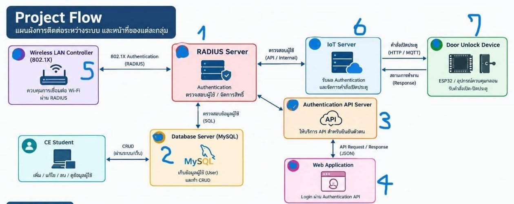

# Door Authentication System — กลุ่ม 2

ฐานข้อมูลกลาง PostgreSQL และเว็บแอดมินสำหรับจัดการผู้ใช้ในโครงการ Wi-Fi 802.1X / IoT Door Access ของ CE04
งานอยู่ใน branch `database-server`



## ระบบปัจจุบัน

- PostgreSQL 17 บน Debian VM: `192.168.100.102:5432`, ฐานข้อมูล `cedatabase`
- เว็บแอดมิน Next.js 16 / React / TypeScript รันบนเครื่องผู้ดูแล เชื่อม DB ผ่าน SSH tunnel ภายในเครือข่ายมหาวิทยาลัย
- เพิ่ม ดู แก้ไข ลบผู้ใช้ ค้นหา เรียงรหัสจากน้อยไปมาก กรองบทบาท/สถานะ/ชั้นปี และนับนักศึกษาปี 1–4
- ผู้ดูแลเข้าสู่ระบบก่อนใช้งาน และกดดูรหัส RADIUS เป็นรายบัญชีได้
- กลุ่ม 1 อ่านผู้ใช้ที่เปิดสิทธิ์ผ่าน `radcheck`; รอผลทดสอบ FreeRADIUS จากกลุ่ม 1
- กลุ่ม 3 ใช้ข้อมูลฐานข้อมูลเพื่อทำ Authentication API; รอข้อสรุปการเชื่อมต่อ
- เว็บนี้เป็นเครื่องมือจัดการฐานข้อมูลของกลุ่ม 2 ส่วนเว็บ Login ผู้ใช้งานหมายเลข 4 เป็นอีกส่วนของโครงการ

## เริ่มใช้งานในเครื่อง

ต้องมี Node.js 20.9 ขึ้นไป, npm และ SSH และเชื่อมต่อเครือข่ายมหาวิทยาลัยตาม [คู่มือ VM](docs/Howto-VM.html)

```bash
npm ci
cp .env.example .env.local
```

กรอก DB credentials ที่ได้รับจากกลุ่ม 2 และตั้ง `ADMIN_USERNAME`, `ADMIN_PASSWORD` (อย่างน้อย 12 ตัวอักษร), `SESSION_SECRET` (สุ่มอย่างน้อย 32 ตัวอักษร) ใน `.env.local`
บัญชีแอดมินเว็บแยกจากบัญชีนักศึกษาและ SSH ส่วน `DB_USER` ต้องเป็นบัญชีที่สร้างแล้วบน VM; `portal_app` ในตัวอย่างต้องสร้างด้วย migration ก่อน
สร้าง session secret ได้ด้วย `openssl rand -hex 32`

เปิด Terminal แรกและค้างไว้:

```bash
python3 scripts/start_tunnel.py
```

กรอกรหัส SSH ที่ได้รับเป็นการส่วนตัว จากนั้นเปิดอีก Terminal:

```bash
npm run dev
```

เปิด [http://localhost:3000](http://localhost:3000) แล้วเข้าสู่ระบบด้วยบัญชีแอดมินที่ตั้งไว้
ข้อมูลที่บันทึกสำเร็จลง PostgreSQL บน VM จริง หาก DB ขัดข้องระบบจะแจ้งข้อผิดพลาด ไม่มีการบันทึกสำรองใน localStorage

ถ้าจะเปิดจากเครื่องอื่นใน LAN ให้ตั้ง `APP_ORIGIN=http://<IP-เครื่องรันเว็บ>:3000` แล้วเริ่มเว็บด้วย `npm run dev -- --hostname 0.0.0.0`
ทุกเครื่องต้องใช้ URL นี้ และเครือข่าย/Firewall ต้องอนุญาตพอร์ต 3000; SSH tunnel ยังเปิดบนเครื่องรันเว็บเพียงเครื่องเดียว

## โครงสร้างและการทดสอบ

- [Schema และข้อมูล master](database/init.sql): ตาราง `users`, `students`, `professors`, `roles`, `departments`, `majors` และ Views
- `database/init.sql` มีบัญชีตัวอย่างสำหรับฐานข้อมูลใหม่ด้วย ไม่ควรรันเพื่อเติมข้อมูลบน VM ที่มีข้อมูลจริงแล้ว
- [คู่มือส่งมอบให้กลุ่ม 1/3](HANDOVER_GUIDE.md)
- [วิธีทดสอบและนำเข้าข้อมูล](docs/TESTING_AND_HANDOVER.md)
- [สถานะล่าสุด](PROJECT_PROGRESS.md)

```bash
npm run lint
npx tsc --noEmit
npm run build
```

Integration tests ใช้ฐานข้อมูลจำลองแยกจาก VM เท่านั้น ดูวิธีตั้งค่าในคู่มือทดสอบ
ไฟล์ `.env.local`, รายชื่อจริง, backups, รหัสผ่าน และไฟล์ agent ไม่รวมใน Git
