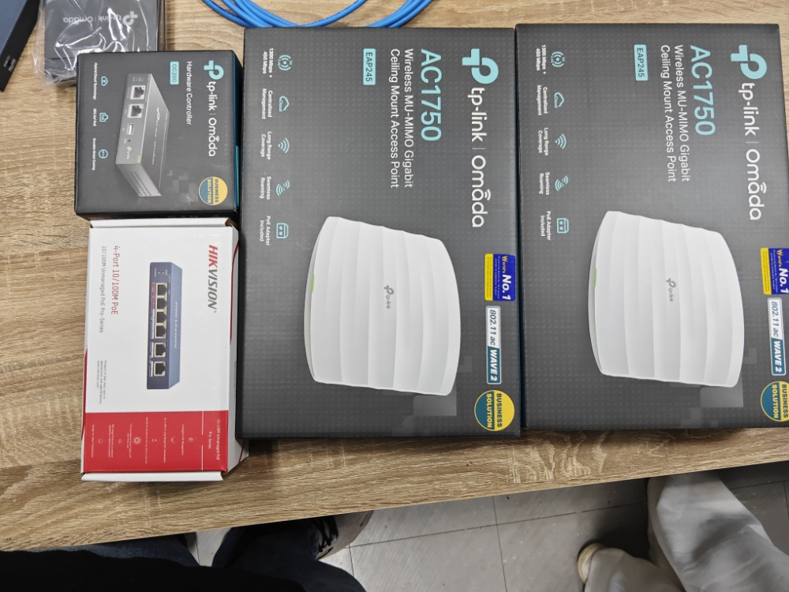
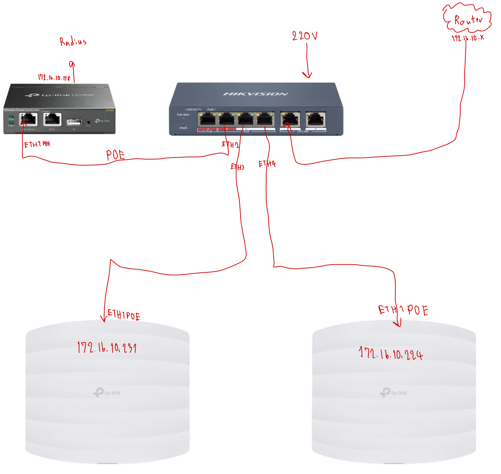
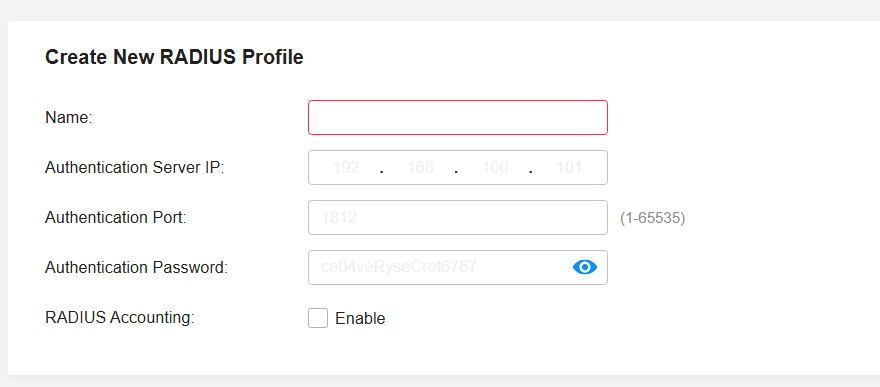
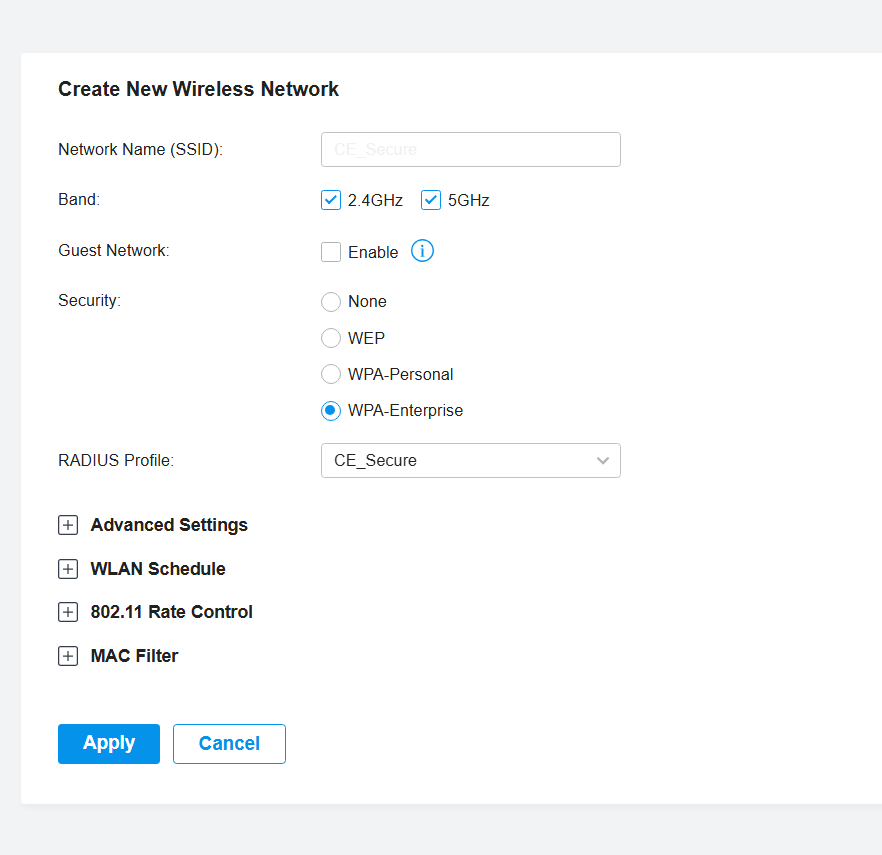
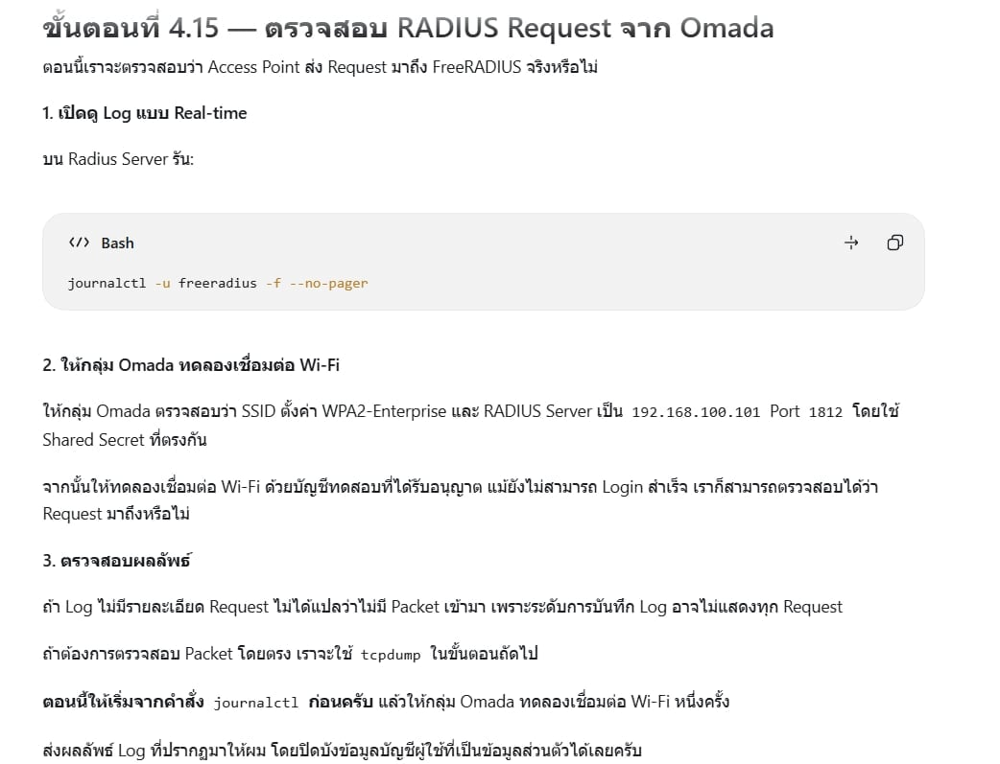
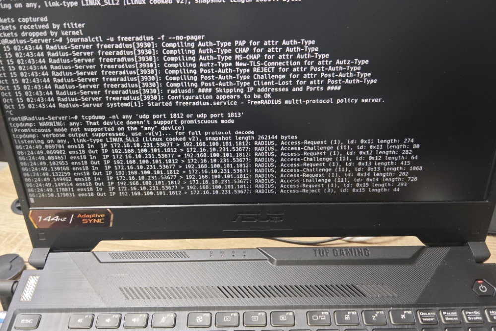

# คู่มือการติดตั้งและตั้งค่าระบบ TP-Link Omada
## สำหรับการยืนยันตัวตนผ่านเครือข่ายไร้สายมาตรฐาน 802.1X (RADIUS)

---

## 1. การเชื่อมต่ออุปกรณ์ฮาร์ดแวร์ (Hardware Setup)

ระบบเครือข่ายส่วนนี้ทำหน้าที่เป็นฝั่งผู้ให้บริการสัญญาณไร้สาย (WLC และ Access Point) โดยใช้ PoE Switch เป็นศูนย์กลางในการจ่ายพลังงานและรับส่งข้อมูล


*ภาพที่ 1: ชุดอุปกรณ์ควบคุม TP-Link OC200, Access Point EAP245 และ Hikvision PoE Switch*

### ขั้นตอนการเดินสาย:

- **การเชื่อมต่ออินเทอร์เน็ต/เครือข่ายหลัก:** นำสาย LAN จาก Router ของสถานที่ (ตัวที่แจกไอพีวง `172.16.x.x`) มาเสียบเข้าที่พอร์ต **Uplink** ของ Hikvision PoE Switch
- **การเชื่อมต่อตัวควบคุม (WLC):** นำสาย LAN เสียบจากพอร์ต **PoE** ของสวิตช์ Hikvision ไปเข้าที่ช่อง **ETH1 (PoE IN)** ของตัวควบคุม TP-Link OC200
- **การเชื่อมต่อตัวกระจายสัญญาณ (AP):** นำสาย LAN เสียบจากพอร์ต **PoE** ของสวิตช์ Hikvision ไปเข้าที่ช่อง **ETH** ของ Access Point (TP-Link EAP245) ทั้ง 2 ตัว

> [!WARNING]
> **ข้อควรระวัง:** ตรวจสอบไฟสถานะบนตัว OC200 และ EAP245 ว่าติดสว่างขึ้นมาหลังจากการเสียบสาย เพื่อยืนยันว่าอุปกรณ์ได้รับกระแสไฟฟ้าจาก PoE Switch อย่างสมบูรณ์

---

### แผนผังการเชื่อมต่อโครงข่ายและอุปกรณ์ (Network Topology & Wiring Diagram)


*แผนภาพแสดงการเชื่อมต่อระหว่าง Router, Hikvision PoE Switch, OC200 Controller, EAP245 Access Points และ RADIUS Server*

#### ตารางสรุปพอร์ตและการกำหนดค่า IP Address:

| อุปกรณ์ (Device) | โมเดล / บทบาท | พอร์ตเชื่อมต่อ (Port) | IP Address | หน้าที่ / การเชื่อมต่อ |
| :--- | :--- | :--- | :--- | :--- |
| **Main Router** | Gateway สถานที่ | LAN Port | `172.16.10.x` | เชื่อมต่อเข้าพอร์ต Uplink ของ PoE Switch |
| **PoE Switch** | Hikvision (แหล่งจ่ายไฟ 220V) | Uplink, ETH2, ETH3, ETH4 | - | จ่ายไฟ PoE และเชื่อมต่อสัญญาณข้อมูล |
| **Hardware Controller** | TP-Link Omada OC200 | ETH1 (PoE IN) | `172.16.10.178` | ควบคุมระบบ APs และชี้ไปยัง RADIUS Server |
| **Access Point 1** | TP-Link EAP245 | ETH1 (PoE) | `172.16.10.231` | กระจายสัญญาณ Wi-Fi WPA-Enterprise (SSID) |
| **Access Point 2** | TP-Link EAP245 | ETH1 (PoE) | `172.16.10.224` | กระจายสัญญาณ Wi-Fi WPA-Enterprise (SSID) |
| **RADIUS Server** | FreeRADIUS Authentication | Ethernet (Port 1812) | `192.168.100.101` | ตรวจสอบบัญชีผู้ใช้งานผ่านโปรโตคอล 802.1X |

---

## 2. การตั้งค่า RADIUS Profile บน Omada Controller

เมื่ออุปกรณ์เชื่อมต่อระบบเครือข่ายและได้รับ IP Address แล้ว ให้เข้าสู่หน้าการจัดการของตัว OC200 ผ่านเว็บบราวเซอร์ (เช่น `https://172.16.10.178`) เพื่อตั้งค่าให้ตัวควบคุมรู้จักกับเซิร์ฟเวอร์ RADIUS


*ภาพที่ 2: การกรอกข้อมูลเซิร์ฟเวอร์ RADIUS สำหรับการตรวจสอบสิทธิ์*

### ขั้นตอนการตั้งค่า RADIUS:

1. ไปที่เมนู **Settings** (รูปเฟืองมุมซ้ายล่าง) > **Authentication** > **RADIUS Profile**
2. คลิกที่ปุ่ม **Create New RADIUS Profile** และกรอกข้อมูลที่ได้ตกลงร่วมกับทีม RADIUS Server:
   - **Name:** กำหนดชื่อโปรไฟล์ (เช่น `CE_Secure`)
   - **Authentication Server IP:** ระบุหมายเลข IP ของเซิร์ฟเวอร์ RADIUS (ตัวอย่าง: `192.168.100.101`)
   - **Authentication Port:** ใช้พอร์ตมาตรฐานคือ `1812` (ช่วงพอร์ต 1-65535)
   - **Authentication Password:** กรอก Shared Secret ให้ตรงกับฝั่งเซิร์ฟเวอร์ (ตัวอย่าง: `ce04veRyseCret6767`)
3. ส่วนของ **RADIUS Accounting** สามารถเว้นว่างไว้ได้ (ไม่ต้องเปิดใช้งาน) จากนั้นกดปุ่ม **Save**

> [!TIP]
> **คำแนะนำเพิ่มเติม:** ข้อมูล Authentication Server IP และ Password ต้องมีความแม่นยำสูง หากกรอกผิดพลาด ตัว Access Point จะไม่สามารถส่งต่อคำขอยืนยันตัวตนไปยังเซิร์ฟเวอร์เป้าหมายได้

---

## 3. การสร้างเครือข่ายไร้สาย (WLAN) ชนิด WPA-Enterprise

หลังจากสร้างโปรไฟล์เซิร์ฟเวอร์ตรวจสอบสิทธิ์เสร็จสิ้น ขั้นตอนต่อไปคือการสร้างชื่อสัญญาณ Wi-Fi (SSID) และกำหนดให้ใช้งานความปลอดภัยระดับองค์กร (802.1X)


*ภาพที่ 3: การตั้งค่าชื่อสัญญาณ (SSID) และเลือกรูปแบบความปลอดภัย WPA-Enterprise*

### ขั้นตอนการตั้งค่าเครือข่าย Wi-Fi:

1. ไปที่เมนู **Settings** > **Wireless Networks** > **WLAN**
2. คลิกที่ **Create New Wireless Network** เพื่อสร้าง SSID ใหม่
3. **Network Name (SSID):** ตั้งชื่อสัญญาณ Wi-Fi ที่ต้องการให้ผู้ใช้งานมองเห็น (ตัวอย่าง: `CE_Secure`)
4. **Band:** เปิดใช้งานทั้ง `2.4GHz` และ `5GHz` เพื่อรองรับอุปกรณ์ที่หลากหลาย
5. **Security:** เลือกรูปแบบเป็น **WPA-Enterprise** เพื่อบังคับให้ผู้ใช้งานต้องกรอกชื่อผู้ใช้และรหัสผ่าน (Username/Password) แทนการใช้รหัสผ่าน Wi-Fi ทั่วไป
6. **RADIUS Profile:** เลือกโปรไฟล์ที่สร้างไว้ในขั้นตอนที่ 2 (เช่น `CE_Secure`)
7. คลิก **Apply** และรอประมาณ 1-2 นาทีเพื่อให้คอนโทรลเลอร์ส่งการตั้งค่าไปบังคับใช้บน Access Point (EAP245)

---

## 4. การทดสอบระบบ (Client Authentication & Logging)

ขั้นตอนสุดท้ายคือการยืนยันการเชื่อมต่อระหว่างอุปกรณ์ไร้สาย, WLC และเซิร์ฟเวอร์ RADIUS เพื่อให้แน่ใจว่าระบบตรวจสอบสิทธิ์ทำงานได้อย่างสมบูรณ์


*ภาพที่ 4: ขั้นตอนการเตรียมการตรวจสอบคำขอบนเครื่องเซิร์ฟเวอร์ RADIUS*

### ขั้นตอนการเตรียมการฝั่ง RADIUS Server:

1. **เปิดดู Log แบบ Real-time บนเครื่อง Radius Server:**
   ```bash
   journalctl -u freeradius -f --no-pager
   ```
2. **ดักจับ Packet ด้วยคำสั่ง tcpdump:**
   ```bash
   tcpdump -ni any 'udp port 1812 or udp port 1813'
   ```

### ขั้นตอนการเชื่อมต่อสำหรับผู้ใช้งาน (Client):

1. เปิดเมนู Wi-Fi บนโทรศัพท์มือถือ หรือเครื่องคอมพิวเตอร์ และเลือกเชื่อมต่อเครือข่าย `CE_Secure`
2. เมื่อระบบแจ้งให้ตั้งค่าความปลอดภัย ให้ระบุรายละเอียดดังนี้:
   - **EAP Method:** เลือก `PEAP`
   - **Phase 2 Authentication:** เลือก `MSCHAPv2`
   - **CA Certificate:** เลือก `Do not validate` (หรือไม่ตรวจสอบใบรับรอง)
3. กรอก **Username** และ **Password** ที่ได้รับอนุญาตจากระบบฐานข้อมูล จากนั้นกด **Connect** (เชื่อมต่อ)

---

## 5. ผลการตรวจสอบฝั่งเซิร์ฟเวอร์ (RADIUS Logging)


*ภาพที่ 5: ผลลัพธ์การดักจับแพ็กเก็ต (Packet Capture) ด้วยคำสั่ง tcpdump ยืนยันการเชื่อมต่อสำเร็จ*

### การวิเคราะห์ผลลัพธ์:

จากภาพที่ 5 จะสังเกตเห็นว่าเซิร์ฟเวอร์ได้รับแพ็กเก็ต `Access-Request` จากฝั่งตัวควบคุม Omada แสดงให้เห็นว่าโครงข่าย (Routing) ได้รับการเชื่อมโยงอย่างถูกต้อง หากบัญชีผู้ใช้งานและรหัสผ่านมีความถูกต้องตรงกับในระบบฐานข้อมูล เซิร์ฟเวอร์จะตอบกลับด้วยแพ็กเก็ต `Access-Accept` เพื่ออนุญาตให้อุปกรณ์เข้าใช้งานอินเทอร์เน็ตได้ทันที

#### ลำดับขั้นตอนการแลกเปลี่ยนแพ็กเก็ต (Packet Flow):
1. **Access-Request:** AP ส่งคำขอยืนยันตัวตนของไคลเอนต์ไปยัง RADIUS Server (IP: `192.168.100.101:1812`)
2. **Access-Challenge:** RADIUS Server ส่ง Challenge กลับมาเพื่อเริ่มกระบวนการยืนยันตัวตน MSCHAPv2
3. **Access-Request:** ไคลเอนต์ส่งรหัสผ่านที่เข้ารหัสแล้วกลับไปตรวจสอบ
4. **Access-Accept:** เมื่อข้อมูลผู้ใช้ถูกต้อง เซิร์ฟเวอร์จะส่งแพ็กเก็ต `Access-Accept` กลับไปยัง AP เพื่ออนุญาตให้เปิดพอร์ตใช้งานอินเทอร์เน็ต
