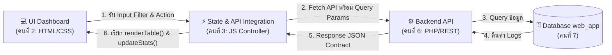

# 📘 คู่มือส่งมอบงานสำหรับคนที่ 3 (Integration & State Management)
**ผู้ส่งมอบ:** คนที่ 2 (Frontend Developer - Teacher Dashboard & UI Components)  
**ผู้รับมอบ:** คนที่ 3 (Frontend Developer - State Management & Search Integration)  
**โปรเจกต์:** Group 4 - Web Application (Access Log & Teacher Dashboard)  
**เวอร์ชันไฟล์:** 1.0 (ตุลาคม 2569)

---

## 📌 สารบัญ
1. [ภาพรวมการเชื่อมต่อระบบ (Workflow Overview)](#1-ภาพรวมการเชื่อมต่อระบบ-workflow-overview)
2. [คู่มืออ้างอิง Element IDs (สำหรับผูกค่าและดึงข้อมูล)](#2-คู่มืออ้างอิง-element-ids-สำหรับผูกค่าและดึงข้อมูล)
3. [เอกสารโครงสร้างข้อมูล (API & JSON Data Contract)](#3-เอกสารโครงสร้างข้อมูล-api--json-data-contract)
4. [ฟังก์ชันสำคัญใน `script.js` ที่จัดเตรียมไว้ให้](#4-ฟังก์ชันสำคัญใน-scriptjs-ที่จัดเตรียมไว้ให้)
5. [คำแนะนำและข้อสังเกตเพิ่มเติมสำหรับคนที่ 3](#5-คำแนะนำและข้อสังเกตเพิ่มเติมสำหรับคนที่-3)

---

## 1. ภาพรวมการเชื่อมต่อระบบ (Workflow Overview)

ในสถาปัตยกรรมของกลุ่ม 4 หน้า Dashboard นี้ทำหน้าที่แสดงผลประวัติการเข้า-ออกห้องเรียนของนักศึกษา โดยคนที่ 3 จะทำหน้าที่เชื่อมโยงระหว่าง:
- **UI Components & Form Controls (คนที่ 2 จัดเตรียมไว้ให้):** Input ฟิลเตอร์, ปุ่มค้นหา, ปุ่มรีเฟรช, ตาราง และ Dropdown เมนู
- **Search & Filter API (คนที่ 6):** ยิง Request พร้อม Query Parameters ไปยัง Backend endpoint (เช่น `api/get_dashboard_data.php`)
- **Database Schema (คนที่ 7):** ตารางฐานข้อมูล `web_app` ที่จัดเก็บฟิลด์ `timestamp`, `student_id`, `student_name`, `room`, และ `status` (`IN` / `OUT`)



---

## 2. คู่มืออ้างอิง Element IDs (สำหรับผูกค่าและดึงข้อมูล)

รายชื่อ ID ของ HTML Elements ในหน้า [index.html](file:///C:/university/year3/term1/security/final/G4-Web%20Application/dashboard/index.html) ที่คนที่ 3 ต้องใช้ในการผูก Event, ดึงค่าพารามิเตอร์ และอัปเดตผลลัพธ์:

### 2.1 ส่วนฟอร์มค้นหาและตัวกรอง (Filter Controls)

| ประเภทคอมโพเนนต์ | Element ID | รูปแบบ Element | คำอธิบาย / หน้าที่ในโค้ด |
| :--- | :--- | :--- | :--- |
| **ช่องค้นหารหัสนักศึกษา** | `studentId` | `<input type="text">` | รับค่าข้อความรหัสนักศึกษาหรือชื่อที่ผู้ใช้กรอก |
| **ตัวเลือกห้องเรียน** | `roomSelect` | `<select>` | Dropdown เลือกห้องเรียน (`all`, `B217`, `B218`, `B316`, `B317`, `E107`, `E111`, `E112`, `B113`) |
| **ตัวเลือกวันที่** | `dateSelect` | `<input type="date">` | ช่องเลือกวันที่บันทึก (ค่ามาตรฐานรูปแบบ `YYYY-MM-DD`) |
| **ตัวเลือกช่วงเวลา** | `timeSelect` | `<select>` | Dropdown เลือกช่วงเวลา (`all`, `08:00` ถึง `22:00` น.) |
| **ปุ่มค้นหา** | `searchBtn` | `<button>` | ปุ่มคลิกเพื่อส่งเงื่อนไข Filter ไปดึงข้อมูลจาก API |
| **ปุ่มรีเฟรช** | `refreshBtn` | `<button>` | ปุ่มล้างค่าการค้นหาและโหลดข้อมูลล่าสุด (มีไอคอนหมุนขณะโหลด) |

### 2.2 ส่วนแสดงผลสถิติและตาราง (Display & Table)

| ประเภทคอมโพเนนต์ | Element ID | รูปแบบ Element | คำอธิบาย / หน้าที่ในโค้ด |
| :--- | :--- | :--- | :--- |
| **การ์ดสถิติ (ห้องใช้งาน)** | `activeRoomsNum` | `<span>` | แสดงตัวเลขจำนวนห้องเรียนที่เปิดใช้งานอยู่ขณะนี้ (เช่น `0` จาก `/ 8 ห้อง`) |
| **การ์ดสถิติ (ยอดเข้าใช้)** | `totalAccessNum` | `<span>` | แสดงตัวเลขยอดรวมการเข้าใช้งานวันนี้ (เช่น `142` ครั้ง) |
| **ตารางแสดงข้อมูล** | `logTableBody` | `<tbody>` | พื้นที่ `<tbody>` สำหรับใส่แถวข้อมูลประวัติการเข้า-ออกห้องเรียน |
| **ข้อมูลจำนวนรายการ** | `paginationInfo` | `<span>` | แสดงข้อความสถานะ Pagination เช่น "แสดง 1 ถึง 10 จากทั้งหมด 142 รายการ" |

### 2.3 ส่วนควบคุมเพิ่มเติม (Header & Navigation)

| ประเภทคอมโพเนนต์ | Element ID | รูปแบบ Element | คำอธิบาย / หน้าที่ในโค้ด |
| :--- | :--- | :--- | :--- |
| **ปุ่มสลับภาษาไทย** | `btnTH` | `<button>` | สลับการแสดงผลภาษาไทย (Class `.active` จะถูกสลับ) |
| **ปุ่มสลับภาษาอังกฤษ** | `btnEN` | `<button>` | สลับการแสดงผลภาษาอังกฤษ |
| **โปรไฟล์อาจารย์** | `userProfileBtn` | `<div>` | ปุ่มเปิด/ปิด Dropdown เมนูโปรไฟล์ |
| **เมนู Dropdown** | `profileDropdown` | `<div>` | กล่องเมนูย่อยของโปรไฟล์ (สลับ Class `.show`) |
| **ปุ่มออกจากระบบ** | `logoutBtn` | `<a>` | ปุ่มคลิกเพื่อ Logout ออกจากระบบ |

---

## 3. เอกสารโครงสร้างข้อมูล (API & JSON Data Contract)

เอกสารอ้างอิงโครงสร้าง JSON ที่สอดคล้องกับตารางฐานข้อมูล `web_app` ของคนที่ 7 (ฟิลด์ `timestamp`, `student_id`, `student_name`, `room`, และ `status` ที่เป็น `IN` หรือ `OUT`) เพื่อให้คนที่ 6 (Backend) จัดเตรียมข้อมูลส่งกลับมา:

### 📥 3.1 Query Parameters ที่ส่งไปหา API (เมื่อกดค้นหาหรือรีเฟรช)

```http
GET api/get_dashboard_data.php?student_id={id}&room={room}&date={date}&time_slot={slot}&lang={lang}
```

| Parameter | ประเภทข้อมูล | ตัวอย่างค่า | คำอธิบาย |
| :--- | :---: | :--- | :--- |
| `student_id` | String | `"65010234"` | รหัสนักศึกษา หรือคำค้นหาชื่อ (ว่างได้หากไม่ระบุ) |
| `room` | String | `"B217"` หรือ `"all"` | รหัสห้องเรียนที่ต้องการกรอง |
| `date` | String | `"2024-10-24"` | วันที่บันทึก (รูปแบบ ISO `YYYY-MM-DD`) |
| `time_slot` | String | `"10:00"` หรือ `"all"` | ช่วงเวลาที่ต้องการกรอง |
| `lang` | String | `"th"` หรือ `"en"` | ภาษาที่ต้องการให้ตอบกลับ (มีผลต่อวันที่และข้อความ) |

### 📤 3.2 โครงสร้าง JSON Response (สิ่งที่ Backend ต้องส่งกลับมา)

```json
{
  "status": "success",
  "activeRooms": 8,
  "totalAccess": 142,
  "logs": [
    {
      "id": "65010234",
      "student_id": "65010234",
      "name": "นายธนภัทร สุขเกษม",
      "student_name": "นายธนภัทร สุขเกษม",
      "room": "B217",
      "roomSub": "Building B / Floor 2",
      "date": "13 ต.ค. 2569",
      "time": "14:30 น.",
      "status": "IN"
    },
    {
      "id": "65010567",
      "student_id": "65010567",
      "name": "นางสาวสมหญิง ตั้งใจ",
      "student_name": "นางสาวสมหญิง ตั้งใจ",
      "room": "E107",
      "roomSub": "Building E / Floor 1",
      "date": "13 ต.ค. 2569",
      "time": "14:15 น.",
      "status": "OUT"
    }
  ]
}
```

---

## 4. ฟังก์ชันสำคัญใน `script.js` ที่จัดเตรียมไว้ให้

คนที่ 2 ได้เตรียม Modular Functions ไว้ใน [script.js](file:///C:/university/year3/term1/security/final/G4-Web%20Application/dashboard/script.js) เพื่อให้คนที่ 3 นำไปเชื่อมต่อได้ทันที:

### 1) `renderTable(logsArray)`
- **หน้าที่:** รับอาร์เรย์ของ logs แล้วสร้างแถว `<tr>` เรนเดอร์ลงใน `#logTableBody`
- **การจัดการสถานะ `status`:**
  - `log.status === 'IN'` ➡️ แสดงป้ายสีเขียว (`status-success`) ข้อความ *"เข้าใช้ห้องเรียน"* (หรือ *"Entering Classroom"*)
  - `log.status === 'OUT'` ➡️ แสดงป้ายสีเทา (`status-gray`) ข้อความ *"ออกจากห้องเรียน"* (หรือ *"Leaving Classroom"*)
- **Empty State อัตโนมัติ:** หาก `logsArray` ว่าง (`[]` หรือ `null`) ฟังก์ชันจะแสดงการแจ้งเตือน **"ยังไม่มีข้อมูลในขณะนี้"** พร้อมไอคอนให้อัตโนมัติ

### 2) `renderLoadingState()`
- **หน้าที่:** แสดง Spinner ไอคอนหมุนและข้อความ *"กำลังโหลดข้อมูล..."* ในตารางขณะที่กำลังรอผลตอบกลับจาก Backend API

### 3) `updateStats(activeRooms, totalAccess)`
- **หน้าที่:** อัปเดตตัวเลขในการ์ด `#activeRoomsNum` และ `#totalAccessNum`

### 4) `updatePagination(totalCount)`
- **หน้าที่:** อัปเดตข้อความใน `#paginationInfo` ให้สอดคล้องกับภาษาและจำนวนรายการจริง

### 5) `switchLanguage(lang)`
- **หน้าที่:** สลับภาษาของ UI ทั้งหน้า (TH/EN) และแปลข้อความในตาราง/Dropdown

---

## 5. คำแนะนำและข้อสังเกตเพิ่มเติมสำหรับคนที่ 3

> [!TIP]
> **การรับส่งฟิลด์ข้อมูล:** ในแต่ละรายการของ `logs` โค้ดของ `renderTable()` รองรับทั้ง `id` หรือ `student_id`, และ `name` หรือ `student_name` เพื่อความยืดหยุ่นในการเชื่อมต่อกับ Database

> [!NOTE]
> **การทำงานขณะไม่มีข้อมูล (Empty State):** ปัจจุบันหน้าเว็บถูกตั้งค่าเริ่มต้นให้เป็น Empty State (`currentLogs = []`) เพื่อรอข้อมูลจริงจาก Database เมื่อคนที่ 3 ทำการ `fetch()` สำเร็จ เพียงส่ง Array ผลลัพธ์เข้าไปที่ `renderTable(result.logs)` ตารางจะแสดงผลข้อมูลจริงทันที

> [!IMPORTANT]
> **Path ของ API Endpoint:** ในโค้ดปัจจุบันถูกระบุไว้เป็น `api/get_dashboard_data.php` หากคนที่ 6 กำหนด Endpoint อื่น (เช่น `/api/v1/logs`) คนที่ 3 สามารถปรับเปลี่ยนได้ที่ตัวแปร `apiUrl` ในฟังก์ชัน `loadDashboardData()`
