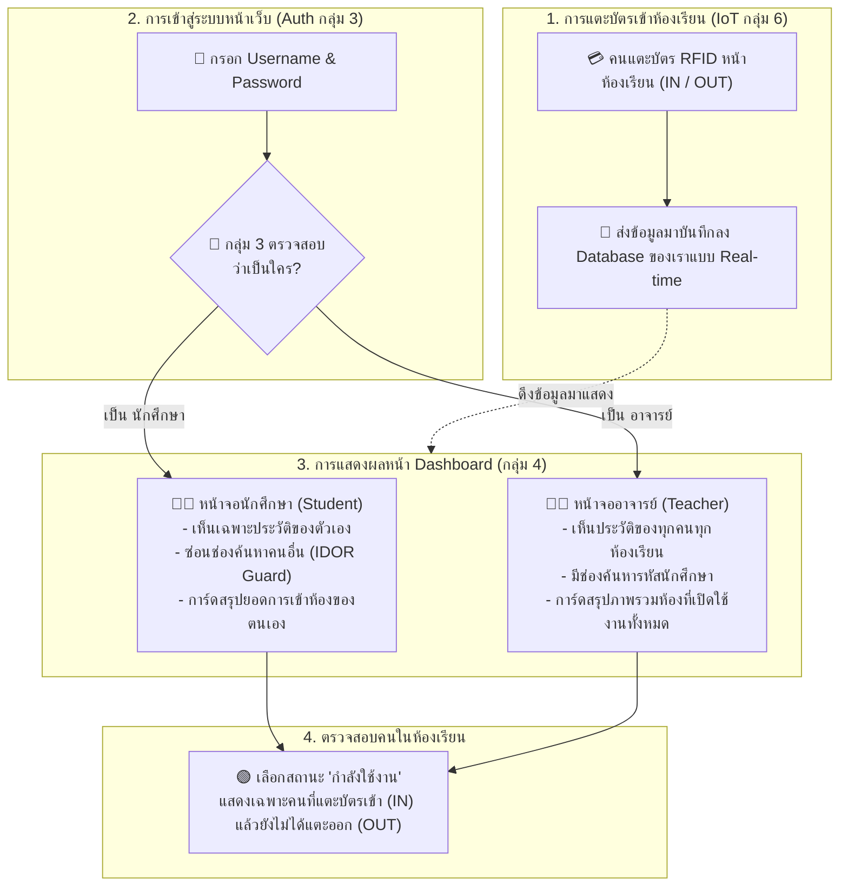

# 💡 โฟลว์การทำงานของระบบเว็บแอปพลิเคชันกลุ่ม 4 แบบเข้าใจง่าย (Simple System Workflow)
**โครงการ:** ระบบจัดการการเข้า-ออกห้องเรียนและวิเคราะห์สถิติ (Classroom Access Management System)  
**ระบบเครือข่าย:** VM4 Proxmox (`http://172.16.10.200:3001`)  

---

## 🖼️ แผนภาพการทำงานแบบเข้าใจง่าย (Simple Diagram)

---

## 📝 อธิบายขั้นตอนการทำงาน 4 ขั้นตอนในชีวิตจริง

### 1. แตะบัตรหน้าห้องเรียน (IoT Data Ingestion)
* นักศึกษาหรืออาจารย์แตะบัตร RFID/NFC ที่หน้าห้องเรียน (เช่น ห้อง B316, B317)
* ข้อมูลเวลาที่แตะบัตร รหัสผู้ใช้ ห้อง และสถานะการเข้า (`IN`) หรือออก (`OUT`) จะถูกส่งข้ามเครือข่ายมาบันทึกลงตาราง `web_app` ในฐานข้อมูลของเราโดยอัตโนมัติทุก 5 วินาที

### 2. ล็อกอินเข้าสู่ระบบ (Authentication via Group 3)
* ผู้ใช้เปิดหน้าเว็บ [http://172.16.10.200:3001/login](http://172.16.10.200:3001/login) และกรอก Username / Password
* ระบบจะส่งข้อมูลไปตรวจสอบความถูกต้องกับระบบยืนยันตัวตนกลาง (กลุ่ม 3)
* กลุ่ม 3 จะตอบกลับมาว่าผู้ใช้คนนี้เป็น **"นักศึกษา" (`student`)** หรือ **"อาจารย์" (`teacher`)** พร้อมชื่อจริง

### 3. แยกมุมมองหน้าจอตามบทบาท (Role-Based Access Control & IDOR Guard)
* **กรณีเป็น นักศึกษา (Student):**
  * ระบบล็อกสิทธิ์ให้เห็นเฉพาะประวัติการเข้าห้องเรียนของตัวเองเท่านั้น (ไม่เห็นของคนอื่น)
  * ซ่อนช่องค้นหาคนอื่นเพื่อความปลอดภัยของข้อมูลส่วนบุคคล (IDOR Protection)
  * การ์ดสถิติจะสรุปเฉพาะยอดการสแกนบัตรของตนเอง
* **กรณีเป็น อาจารย์ (Teacher):**
  * สามารถดูประวัติการเข้า-ออกห้องเรียนของทุกคน ทุกห้องเรียนได้
  * มีช่องพิมพ์ค้นหาตามรหัสนักศึกษา หรือกรองดูเฉพาะห้องที่ต้องการได้
  * การ์ดสถิติจะสรุปภาพรวมจำนวนห้องที่เปิดใช้งาน และยอดการใช้งานรวมทั้งหมด

### 4. ตรวจเช็กคนในห้องเรียนแบบสด ๆ (Active Occupancy Tracking)
* หากผู้ใช้เลือกสถานะในตัวกรองเป็น **"กำลังใช้งาน" (`ACTIVE`)**
* ระบบจะคัดกรองแสดงเฉพาะคนที่แตะบัตรเข้าห้อง (`IN`) และยังไม่ได้แตะบัตรออก (`OUT`) เท่านั้น ทำให้ทราบได้ทันทีว่าใครกำลังนั่งอยู่ในห้องเรียนขณะนี้แบบ Real-time
