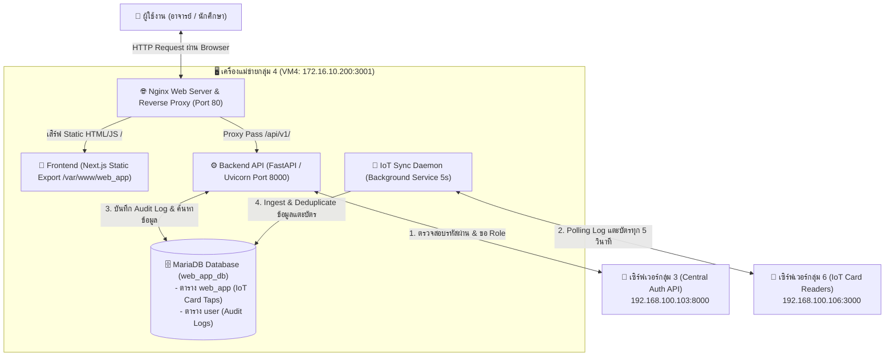
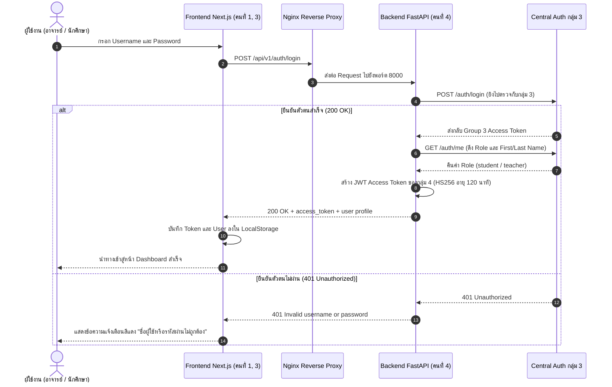
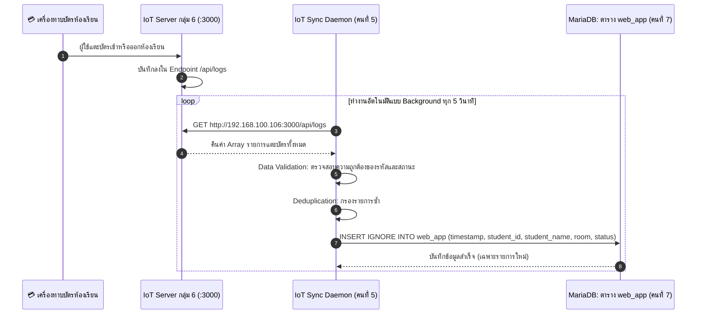
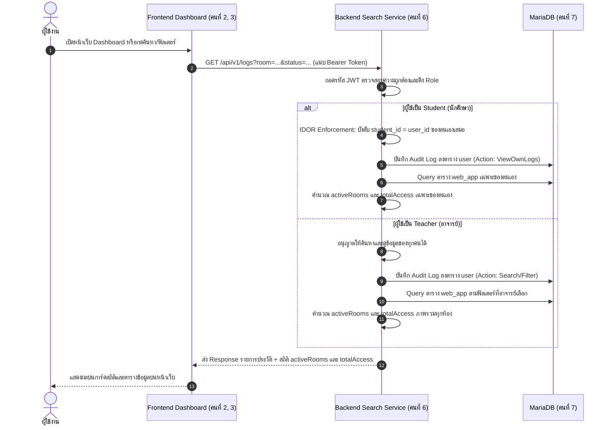

# 📘 เอกสารโฟลว์การทำงานของระบบเว็บแอปพลิเคชัน กลุ่ม 4 (System Workflow Documentation)
**โครงการ:** Classroom Access Management & Teacher Dashboard Security System  
**เครือข่าย VM:** VM4 Proxmox (`172.16.10.200:3001` / Private IP: `192.168.100.104`)  
**ปรับปรุงล่าสุด:** 20 ตุลาคม 2026  

---

## 📑 สารบัญ (Table of Contents)
1. [ภาพรวมของระบบ (System Overview)](#1-ภาพรวมของระบบ-system-overview)
2. [สถาปัตยกรรมระบบ (System Architecture)](#2-สถาปัตยกรรมระบบ-system-architecture)
3. [โฟลว์การทำงานหลักของระบบ (Core Workflows)](#3-โฟลว์การทำงานหลักของระบบ-core-workflows)
   - [Flow 1: การเข้าสู่ระบบและยืนยันตัวตน (Authentication Flow)](#flow-1-การเข้าสู่ระบบและยืนยันตัวตน-authentication-flow)
   - [Flow 2: การดึงข้อมูลแตะบัตรจาก IoT กลุ่ม 6 (IoT Real-time Ingestion Flow)](#flow-2-การดึงข้อมูลแตะบัตรจาก-iot-กลุ่ม-6-iot-real-time-ingestion-flow)
   - [Flow 3: การแสดงผล Dashboard, ค้นหา และ IDOR Protection Flow](#flow-3-การแสดงผล-dashboard-ค้นหา-และ-idor-protection-flow)
   - [Flow 4: การค้นหาสถานะ "กำลังใช้งาน" (Active Occupancy Tracking)](#flow-4-การค้นหาสถานะ-กำลังใช้งาน-active-occupancy-tracking)
   - [Flow 5: การบันทึกหลักฐานความมั่นคงปลอดภัย (Audit Trail Logging Flow)](#flow-5-การบันทึกหลักฐานความมั่นคงปลอดภัย-audit-trail-logging-flow)
4. [โครงสร้างฐานข้อมูล (Database Schema Specifications)](#4-โครงสร้างฐานข้อมูล-database-schema-specifications)
5. [การแบ่งหน้าที่ของสมาชิกกลุ่ม 4 (Roles & Responsibilities: Person 1 - 7)](#5-การแบ่งหน้าที่ของสมาชิกกลุ่ม-4-roles--responsibilities-person-1---7)
6. [คำสั่งตรวจสอบและจัดการระบบ (System Operations & Commands)](#6-คำสั่งตรวจสอบและจัดการระบบ-system-operations--commands)

---

## 1. ภาพรวมของระบบ (System Overview)

ระบบเว็บแอปพลิเคชันกลุ่ม 4 ทำหน้าที่เป็นศูนย์กลางในการบริหารจัดการและตรวจสอบประวัติการเข้า-ออกห้องเรียนอัจฉริยะ (Smart Classroom Access) พร้อมระบบวิเคราะห์ข้อมูล (Dashboard) และการรักษาความมั่นคงปลอดภัยของข้อมูลส่วนบุคคลตามมาตรฐานสากล

### การเชื่อมต่อกับกลุ่มภายนอก (Cross-Group Integrations)
1. **กลุ่ม 3 (Central Authentication Server - `192.168.100.103:8000`):**
   * ตรวจสอบความถูกต้องของ Username และ Password
   * ดึงสิทธิ์ของผู้ใช้ (`role`: `teacher` หรือ `student`) และข้อมูลโปรไฟล์จริง
2. **กลุ่ม 6 (IoT Hardware & Card Readers - `192.168.100.106:3000`):**
   * ดึงข้อมูลการแตะบัตร RFID/NFC เข้า-ออกห้องเรียน (เช่น ห้อง B316, B317) แบบ Real-time ผ่าน REST API

---

## 2. สถาปัตยกรรมระบบ (System Architecture)



---

## 3. โฟลว์การทำงานหลักของระบบ (Core Workflows)

### Flow 1: การเข้าสู่ระบบและยืนยันตัวตน (Authentication Flow)



---

### Flow 2: การดึงข้อมูลแตะบัตรจาก IoT กลุ่ม 6 (IoT Real-time Ingestion Flow)



---

### Flow 3: การแสดงผล Dashboard, ค้นหา และ IDOR Protection Flow



---

### Flow 4: การค้นหาสถานะ "กำลังใช้งาน" (Active Occupancy Tracking)

เมื่อผู้ใช้เลือกสถานะ **"กำลังใช้งาน" (`ACTIVE`)** บนหน้า Dashboard:
1. Frontend ส่ง Request: `GET /api/v1/logs?status=ACTIVE`
2. Backend ตรวจสอบสถานะการอยู่ในห้องด้วย Subquery:
   ```sql
   WHERE id IN (SELECT MAX(id) FROM web_app GROUP BY student_id) AND status = 'IN'
   ```
3. **ผลลัพธ์:**
   * หากนักศึกษาแตะบัตรเข้า (`IN`) และยังไม่ได้แตะบัตรออก (`OUT`) $\rightarrow$ รายชื่อจะปรากฏในสถานะ "กำลังใช้งาน"
   * ทันทีที่แตะบัตรออก (`OUT`) ประวัติล่าสุดจะกลายเป็น `OUT` $\rightarrow$ รายชื่อจะหลุดออกจากรายการนี้ทันทีแบบ Real-time
   * การ์ด `activeRooms` จะสรุปจำนวนห้องที่มีคนนั่งอยู่จริง และ `totalAccess` จะแสดงจำนวนคนที่กำลังอยู่ในห้องขณะนั้น

---

### Flow 5: การบันทึกหลักฐานความมั่นคงปลอดภัย (Audit Trail Logging Flow)

ทุกครั้งที่มีการเรียกดูข้อมูล, ค้นหา หรือกรองข้อมูลในระบบ:
1. Backend จะตรวจจับผู้ใช้งานและคำสั่งค้นหา
2. บันทึกข้อมูลลงตาราง **`user`** แบบ Asynchronous Thread ทันที:
   * **`id`:** ลำดับเหตุการณ์ (Auto Increment เริ่มจาก 1)
   * **`timestamp`:** เวลาที่เข้าใช้งานจริงตามเขตเวลาประเทศไทย (`Asia/Bangkok` UTC+7)
   * **`username`:** รหัสผู้ใช้งานที่เข้ามาใช้งาน
   * **`role`:** บทบาท (`teacher` หรือ `student`)
   * **`action`:** กิจกรรมที่กระทำ เช่น `ViewOwnLogs>student_id=67200324`, `Filter>room=B316`, `Filter>status=ACTIVE`

---

## 4. โครงสร้างฐานข้อมูล (Database Schema Specifications)

ฐานข้อมูลหลักชื่อ **`web_app_db`** ประกอบด้วย 2 ตาราง:

### 1. ตาราง `web_app` (บันทึกการแตะบัตรเข้าห้องเรียนจาก IoT)
| คอลัมน์ | ชนิดข้อมูล | คุณสมบัติ | คำอธิบาย |
| :--- | :--- | :---: | :--- |
| `id` | `bigint unsigned` | Primary Key, Auto Increment | รหัสลำดับรายการ |
| `timestamp` | `datetime` | Indexed | เวลาที่สแกนบัตรจริงจากเครื่อง IoT (UTC+7) |
| `student_id` | `varchar(20)` | Indexed | รหัสผู้ใช้งาน / รหัสนักศึกษา / รหัสอาจารย์ |
| `student_name` | `varchar(150)` | - | ชื่อ-นามสกุล |
| `room` | `varchar(10)` | Indexed | รหัสห้องเรียน เช่น B316, B317 |
| `status` | `enum('IN','OUT')` | Indexed | สถานะการเข้า (`IN`) หรือออก (`OUT`) |

### 2. ตาราง `user` (Audit Log บันทึกประวัติการใช้เว็บ)
| คอลัมน์ | ชนิดข้อมูล | คุณสมบัติ | คำอธิบาย |
| :--- | :--- | :---: | :--- |
| `id` | `bigint unsigned` | Primary Key, Auto Increment | ลำดับการใช้งาน (เรียงจาก 1) |
| `timestamp` | `datetime` | Indexed | วันเวลาจริงที่เข้าใช้งานเว็บ (UTC+7) อยู่หน้า username |
| `username` | `varchar(100)` | Indexed | บัญชีผู้ใช้งานที่ทำรายการ |
| `role` | `enum('teacher','student')` | - | สิทธิ์ของผู้ใช้งาน |
| `action` | `varchar(255)` | - | รายละเอียดกิจกรรมที่กระทำบนเว็บ |

---

## 5. การแบ่งหน้าที่ของสมาชิกกลุ่ม 4 (Roles & Responsibilities: Person 1 - 7)

* **คนที่ 1 (Frontend Auth & Design UI):** ออกแบบหน้า Login, จัดการ Responsive Design, รองรับสองภาษา (TH/EN) และการควบคุม Session ฝั่ง Client
* **คนที่ 2 (Frontend Dashboard & Visuals):** จัดทำหน้า Dashboard แสดงรายการแตะบัตร, การ์ดแสดงผลสถิติภาพรวม, ตัวกรองข้อมูล และระบบ Pagination
* **คนที่ 3 (Frontend Security & RBAC Guard):** ควบคุมการแสดงผลตามสิทธิ์ (Student vs Teacher), ซ่อนช่องค้นหาคนอื่นสำหรับนักศึกษา และป้องกัน IDOR ฝั่ง UI
* **คนที่ 4 (Backend Authentication & Audit Trail):** เชื่อมต่อ API กลุ่ม 3 ตรวจสอบรหัสผ่าน, ออก JWT Access Token, Middleware ตรวจสอบ Role และบันทึก Audit Log ลงตาราง `user`
* **คนที่ 5 (Backend IoT Data Ingestion Pipeline):** พัฒนาระบบดึงข้อมูลจาก Server กลุ่ม 6, คัดกรองความถูกต้อง (Data Validation) และตัดข้อมูลซ้ำก่อนบันทึกลงฐานข้อมูล
* **คนที่ 6 (Backend Access Log & Search API):** พัฒนา Search API `/api/v1/logs`, ระบบกรองข้อมูล, ค้นหาสถานะ "กำลังใช้งาน" (`ACTIVE`) และคำนวณสถิติแบบไดนามิก
* **คนที่ 7 (DBA & DevOps Infrastructure):** ออกแบบและดูแลฐานข้อมูล MariaDB, ติดตั้ง Nginx Reverse Proxy, ตั้งค่า Timezone ระบบ (`Asia/Bangkok`), จัดการ PM2 Services และดูแลความปลอดภัยของเครื่องแม่ข่าย VM4

---

## 6. คำสั่งตรวจสอบและจัดการระบบ (System Operations & Commands)

### เรียกดูข้อมูลในฐานข้อมูล (รันบน Terminal ของ VM4)
* **ดูข้อมูลทั้ง 2 ตารางพร้อมกันทั้งหมด:**
  ```bash
  mysql -u app_backend -p'Password1234!' web_app_db -e "
  SELECT '=== 1. ตาราง user (Audit Log) ===' AS '';
  SELECT * FROM user ORDER BY id ASC;
  SELECT '=== 2. ตาราง web_app (IoT Access Log) ===' AS '';
  SELECT * FROM web_app ORDER BY id ASC;
  "
  ```

* **ดูเฉพาะคนที่กำลังใช้งานห้องเรียนอยู่ ณ ปัจจุบัน (มีเฉพาะ IN ยังไม่ OUT):**
  ```bash
  mysql -u app_backend -p'Password1234!' web_app_db -e "
  SELECT id, timestamp, student_id, student_name, room, status 
  FROM web_app 
  WHERE id IN (SELECT MAX(id) FROM web_app GROUP BY student_id) AND status = 'IN';
  "
  ```

### จัดการ Service บน VM4
```bash
# ตรวจสอบสถานะ Background Services ทั้งหมด
pm2 list

# รีสตาร์ต Backend API และ IoT Sync
pm2 restart member6-api
pm2 restart iot-sync

# รีโหลด Nginx Web Server
systemctl reload nginx
```
