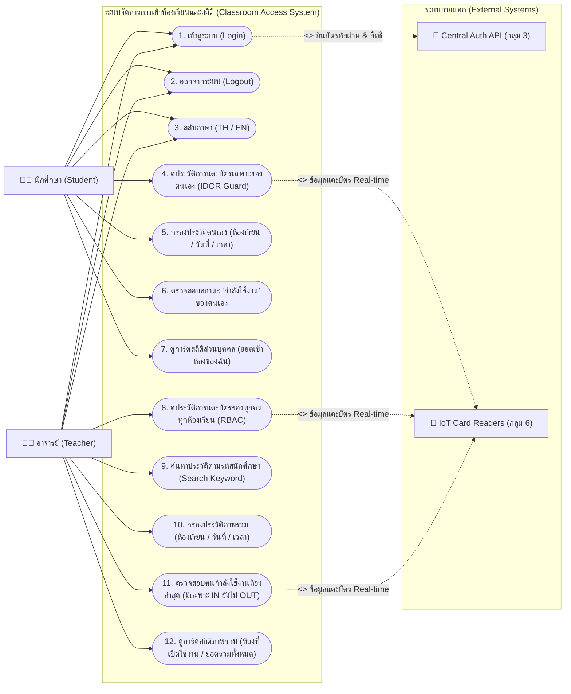

# 📊 แผนภาพ Use Case Diagram ระบบเว็บแอปพลิเคชันกลุ่ม 4
**โครงการ:** ระบบจัดการการเข้าห้องเรียนอัจฉริยะ (Classroom Access Management System)  
**ระบบเครือข่าย:** VM4 Proxmox (`http://172.16.10.200:3001`)  

---

## 🖼️ แผนภาพ Use Case Diagram

---

## 📋 รายละเอียดการเปรียบเทียบสิทธิ์และ Use Cases

| Use Case (ฟังก์ชันการใช้งาน) | นักศึกษา (Student) | อาจารย์ (Teacher) | คำอธิบายและมาตรการความปลอดภัย |
| :--- | :---: | :---: | :--- |
| **1. เข้าสู่ระบบ (Login)** | ✅ | ✅ | ส่งไปตรวจสอบ Username/Password กับ API กลุ่ม 3 |
| **2. ออกจากระบบ (Logout)** | ✅ | ✅ | ลบ Token ออกจาก Browser Session |
| **3. สลับภาษา (TH / EN)** | ✅ | ✅ | สลับภาษาในหน้า Dashboard และตารางข้อมูล |
| **4. ขอบเขตข้อมูลประวัติแตะบัตร** | **เฉพาะของตนเอง** | **ทุกคนทุกห้อง** | **IDOR Protection:** นักศึกษาจะถูกล็อก Scope ให้ดูได้เฉพาะของตนเองเสมอ |
| **5. ค้นหารหัสนักศึกษาคนอื่น** | ❌ *(ซ่อนช่องค้นหา)* | ✅ | อาจารย์สามารถพิมพ์ค้นหารหัสนักศึกษาเพื่อดูประวัติเจาะจงได้ |
| **6. กรองตามห้องเรียน / วันที่ / เวลา** | ✅ *(กรองเฉพาะของตนเอง)* | ✅ *(กรองภาพรวมทุกคน)* | กรองประวัติตามเงื่อนไขห้อง วันที่ และช่วงเวลา |
| **7. ค้นหาสถานะ "กำลังใช้งาน"** | ✅ | ✅ | แสดงเฉพาะคนที่กำลังใช้งานห้องเรียนล่าสุด (มีแค่ `IN` ยังไม่ `OUT`) |
| **8. การ์ดสถานะห้องเรียน (`activeRooms`)** | **ห้องที่ตนเองเข้าวันนี้** | **ทุกห้องที่เปิดใช้งานวันนี้** | คำนวณสรุปจำนวนห้องที่ active ตามขอบเขตบทบาท |
| **9. การ์ดยอดการเข้าใช้งาน (`totalAccess`)** | **ยอดสแกนบัตรของฉัน** | **ยอดสแกนบัตรของทุกคน** | สรุปจำนวนครั้งการแตะบัตรเข้า-ออกห้องเรียน |
| **10. การบันทึก Audit Log ลงตาราง `user`** | ✅ *(ViewOwnLogs)* | ✅ *(Search/Filter)* | บันทึกประวัติการสืบค้นเพื่อความปลอดภัยและตรวจสอบย้อนหลังได้ |
