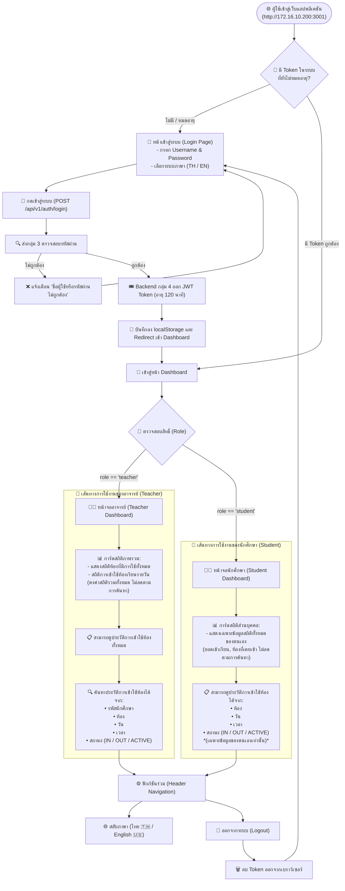

# 🧭 แผนผังเส้นทางการใช้งานของผู้ใช้ (User Flow) — กลุ่ม 4
**โครงการ:** ระบบจัดการการเข้าห้องเรียนอัจฉริยะและแดชบอร์ดความปลอดภัย (Classroom Access Management System)  
**ระบบเครือข่าย:** VM4 Proxmox (`http://172.16.10.200:3001`)  
**ไฟล์ภาพและหน้าเว็บ:** [`USER_FLOW.html`](USER_FLOW.html) | [`USER_FLOW.md`](USER_FLOW.md)

---

## 📌 สรุปเส้นทางการใช้งานของผู้ใช้ (User Flow Summary)

ผู้ใช้ทุกคนเริ่มต้นเข้าใช้งานจาก **หน้าเข้าสู่ระบบ (Login Page)** ร่วมกัน โดยส่งตรวจสอบรหัสผ่านกับระบบกลุ่ม 3 และรับ Token ของกลุ่ม 4 จากนั้นระบบจะแยกเส้นทางตามบทบาท (Role) ดังนี้:

### 👨‍🏫 หากเป็น อาจารย์ (Teacher):
1. **การ์ดสรุปสถิติภาพรวม:** แสดงข้อมูลสถิติภาพรวมทั้งหมด ได้แก่ จำนวนห้องที่มีการใช้งานทั้งหมด, สถิติการเข้าใช้ห้องเรียนรายวัน (การ์ดจะคงค่าสถิติรวมของระบบเสมอ ไม่ลดลงตามการค้นหา)
2. **สามารถดูประวัติการเข้าใช้ห้องทั้งหมด**
3. **ค้นหาประวัติการเข้าใช้ห้องได้จาก:**
   * **รหัสนักศึกษา**
   * **ห้อง**
   * **วัน**
   * **เวลา**
   * **สถานะ** (ทั้งหมด, เข้าห้อง `IN`, ออกจากห้อง `OUT`, หรือกำลังใช้งาน `ACTIVE`)

---

### 🧑‍🎓 หากเป็น นักศึกษา (Student):
1. **การ์ดสรุปสถิติส่วนบุคคล:** แสดงเฉพาะข้อมูลสถิติทั้งหมดของตนเอง (จำนวนครั้งที่เข้าเรียน, จำนวนห้องที่เคยเข้า) ไม่แสดงตามการค้นหา
2. **สามารถดูประวัติการเข้าใช้ห้องได้จาก:**
   * **ห้อง**
   * **วัน**
   * **เวลา**
   * **สถานะ** (ทั้งหมด, เข้าห้อง `IN`, ออกจากห้อง `OUT`, หรือกำลังใช้งาน `ACTIVE`)  
   *(หมายเหตุ: ป้องกัน IDOR โดยล็อกให้ดูได้เฉพาะข้อมูลของตนเอง และไม่มีช่องให้ค้นหารหัสนักศึกษาคนอื่น)*

---

## 🖼️ แผนภาพ User Flow Diagram (Mermaid)

---

## ⚖️ ตารางสรุปเปรียบเทียบการใช้งานระหว่าง อาจารย์ vs นักศึกษา

| ส่วนประกอบ | บทบาท อาจารย์ (Teacher) | บทบาท นักศึกษา (Student) |
|---|---|---|
| **การ์ดสรุปสถิติ** | • แสดงห้องที่มีการใช้ทั้งหมดกี่ห้อง • สถิติการเข้าใช้ห้องเรียนรายวัน *(แสดงข้อมูลภาพรวมทั้งหมด ไม่ลดตามการค้นหา)* | • แสดงเฉพาะข้อมูลสถิติทั้งหมดของตนเอง *(ไม่แสดงข้อมูลคนอื่น และไม่ลดตามการค้นหา)* |
| **การดูประวัติเข้าใช้ห้อง** | **สามารถดูประวัติการเข้าใช้ห้องทั้งหมด** | **สามารถดูประวัติการเข้าใช้ห้องเฉพาะของตนเอง** |
| **เงื่อนไขที่สามารถค้นหาได้** | ค้นหาได้จาก: 1. **รหัสนักศึกษา** 2. **ห้อง** 3. **วัน** 4. **เวลา** 5. **สถานะ** | ค้นหาได้จาก: 1. **ห้อง** 2. **วัน** 3. **เวลา** 4. **สถานะ** *(ไม่มีรหัสนักศึกษา ป้องกัน IDOR)* |
| **การซิงก์ข้อมูล IoT** | มีปุ่มกดสั่งซิงก์ดึงข้อมูลสดจากกลุ่ม 6 | ซิงก์ข้อมูลอัตโนมัติผ่าน Background Worker |
| **การออกจากระบบ** | กด Logout ลบ Token กลับสู่หน้า Login | กด Logout ลบ Token กลับสู่หน้า Login |
