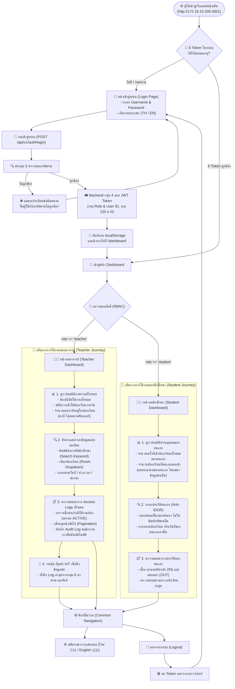

# 🧭 แผนผังเส้นทางการใช้งานของผู้ใช้ (User Flow) — กลุ่ม 4
**โครงการ:** ระบบจัดการการเข้าห้องเรียนอัจฉริยะและแดชบอร์ดความปลอดภัย (Classroom Access Management System)  
**ระบบเครือข่าย:** VM4 Proxmox (`http://172.16.10.200:3001`)  
**ไฟล์ภาพและหน้าเว็บ:** [`USER_FLOW.html`](USER_FLOW.html) | [`USER_FLOW.md`](USER_FLOW.md)

---

## 📌 ภาพรวม User Flow (User Flow Overview)

User Flow ของระบบกลุ่ม 4 ถูกออกแบบภายใต้หลักการ **Role-Based Access Control (RBAC)** และ **Zero-Trust Security** โดยผู้ใช้งานทุกคนเริ่มต้นจากหน้าเดียวกัน (Single Portal) คือ **หน้าเข้าสู่ระบบ (Login Page)** แต่ระบบจะแยกเส้นทางการใช้งาน (Flow Divergence) ออกเป็น 2 บทบาทอย่างชัดเจนตามสิทธิ์ที่ระบุไว้ใน **JWT Token**:

1. **เส้นทางของอาจารย์ (Teacher Flow):** เน้นการกำกับดูแลภาพรวม การตรวจสอบห้องเรียน การวิเคราะห์สถิติรายวัน และการตรวจสอบผู้ที่กำลังอยู่ในห้องเรียน
2. **เส้นทางของนักศึกษา (Student Flow):** เน้นการตรวจสอบสถิติและประวัติการแตะบัตรเข้าห้องเรียนของตนเอง โดยมีกลไกป้องกันการเข้าถึงข้อมูลของผู้อื่น (Anti-IDOR) อย่างเข้มงวด

---

## 🖼️ แผนภาพ User Flow Diagram (Mermaid)

---

## 📋 รายละเอียดขั้นตอนการใช้งานแยกตามบทบาท

### 1. เส้นทางการใช้งานของอาจารย์ (Teacher Flow)

| ลำดับขั้นตอน | กิจกรรมของผู้สอน (Action) | หน้าจอและการตอบสนองของระบบ (System Response) |
|---|---|---|
| **1. การเข้าสู่ระบบ** | กรอก Username/Password ของอาจารย์ที่หน้า `/login` | ตรวจสอบผ่านกลุ่ม 3 และสร้าง Token สิทธิ์ `role: teacher` นำทางเข้าสู่หน้า Dashboard ของอาจารย์ |
| **2. ดูสถิติภาพรวม** | ตรวจดูการ์ดสรุปสถิติด้านบนของหน้าจอ | แสดงสถิติ **ภาพรวมทั้งระบบ**:  • จำนวนห้องที่มีการใช้งานทั้งหมด • สถิติยอดการเข้าใช้ห้องเรียนรวมทั้งระบบ • ผู้ที่กำลังอยู่ในห้องเรียน (ACTIVE) *(การ์ดจะคงค่าสถิติรวมของระบบเสมอ ไม่ลดลงตามการฟิลเตอร์ตาราง)* |
| **3. ค้นหาและกรองข้อมูล** | • พิมพ์รหัสนักศึกษาลงช่องค้นหา • เลือกห้องเรียน (เช่น EN4101, B316) • เลือกวันที่ หรือช่วงเวลา (เช้า/บ่าย/ค่ำ) • เลือกสถานะ `ACTIVE` เพื่อดูคนที่ยังไม่ออกจากห้อง | ตารางด้านล่างจะอัปเดตแสดงเฉพาะรายการที่ตรงกับเงื่อนไขการค้นหาทันที พร้อมระบบบันทึก Audit Log ลงตาราง `user` เพื่อตรวจสอบย้อนหลัง |
| **4. ตรวจสอบตารางประวัติ** | เลื่อนดูรายการแตะบัตร (Log Table) และกดเปลี่ยนหน้า (Pagination) | แสดงข้อมูล: รหัสนักศึกษา, ชื่อ-นามสกุล, ห้องเรียน, วันที่เวลาแตะบัตร, และสถานะการเข้า-ออก |
| **5. อัปเดตข้อมูลสด (Sync IoT)** | กดปุ่ม **"ซิงก์ข้อมูล IoT"** บนแถบตัวกรอง | ระบบส่งคำขอไปยังเซิร์ฟเวอร์กลุ่ม 6 เพื่อดึงข้อมูล Log ล่าสุดมาบันทึกลงฐานข้อมูลและรีเฟรชหน้าจอทันที |
| **6. สลับภาษา / ออกจากระบบ** | กดปุ่มเปลี่ยนภาษา (TH/EN) หรือกดปุ่ม Logout | สลับภาษาอินเทอร์เฟซทันที หรือล้าง Token ในเครื่องแล้วกลับไปหน้าเข้าสู่ระบบอย่างปลอดภัย |

---

### 2. เส้นทางการใช้งานของนักศึกษา (Student Flow)

| ลำดับขั้นตอน | กิจกรรมของนักศึกษา (Action) | หน้าจอและการตอบสนองของระบบ (System Response) |
|---|---|---|
| **1. การเข้าสู่ระบบ** | กรอกรหัสนักศึกษา (เช่น `67200324`) และรหัสผ่านที่หน้า `/login` | ตรวจสอบผ่านกลุ่ม 3 และออก Token ระบุ `role: student`, `sub: 67200324` นำทางเข้าสู่หน้าจอนักศึกษา |
| **2. ดูสถิติส่วนบุคคล** | ตรวจดูการ์ดสรุปสถิติด้านบนของหน้าจอ | แสดงสถิติ **เฉพาะของตนเองเท่านั้น**:  • จำนวนครั้งที่ตนเองแตะบัตรเข้าห้องเรียนทั้งหมด • จำนวนห้องเรียนที่ตนเองเคยเข้าเรียน *(ไม่แสดงสถิติรวมของผู้อื่น และไม่เปลี่ยนแปลงตามการค้นหา)* |
| **3. กรองประวัติตนเอง (Anti-IDOR)** | • เลือกดูตามห้องเรียนที่ตนเองเคยเข้า • เลือกดูตามวันที่ที่เคยเข้าเรียน | **ระบบความปลอดภัย:** ซ่อน/ล็อกช่องค้นหารหัส ไม่เปิดช่องให้พิมพ์รหัสนักศึกษาคนอื่น ระบบบังคับกรองเฉพาะ `student_id` ของตนเองเสมอ |
| **4. ตรวจสอบประวัติตนเอง** | ตรวจสอบเวลาที่แตะบัตรเข้าเรียนในตาราง | ตารางแสดงเฉพาะประวัติของตนเอง เพื่อตรวจสอบว่าบัตรแตะติดหรือไม่ เวลาเข้าเรียนถูกต้องหรือไม่ |
| **5. สลับภาษา / ออกจากระบบ** | กดปุ่มเปลี่ยนภาษา (TH/EN) หรือกดปุ่ม Logout | ทำลายเซสชันการใช้งานทันที ป้องกันผู้อื่นมาใช้งานต่อบนเครื่องสาธารณะ |

---

## ⚖️ ตารางเปรียบเทียบหน้าจอระหว่าง อาจารย์ vs นักศึกษา

| ส่วนประกอบของหน้าจอ (UI Component) | มุมมองของอาจารย์ (Teacher View) | มุมมองของนักศึกษา (Student View) |
|---|---|---|
| **การ์ดสรุปสถิติ (Stat Cards)** | แสดงสถิติภาพรวมทั้งระบบ (ทุกห้อง, ทุกคน) | แสดงเฉพาะสถิติส่วนบุคคลของตนเอง |
| **พฤติกรรมการคงค่าการ์ดสถิติ** | คงที่ตามสถิติรวมของระบบเสมอ (ไม่ลดตามการค้นหา) | คงที่ตามสถิติรวมของตนเองเสมอ (ไม่ลดตามการค้นหา) |
| **ช่องพิมพ์ค้นหารหัสนักศึกษา** | ✅ มีช่องพิมพ์ค้นหาได้อย่างอิสระ | ❌ ซ่อน/ปิดการใช้งาน (ป้องกันช่องโหว่ IDOR) |
| **ตัวกรองห้องเรียน / วันที่ / เวลา** | ✅ เลือกดูได้ทุกห้อง ทุกวัน | ✅ เลือกดูได้เฉพาะประวัติตนเอง |
| **ตัวกรองสถานะ ACTIVE** | ✅ ดูได้ว่าขณะนี้มีนักศึกษาคนไหนอยู่ในห้องบ้าง | ✅ ตรวจสอบว่าตนเองมีสถานะยังอยู่ในห้องหรือไม่ |
| **ตารางประวัติ (Access Log Table)** | แสดงรายการของนักศึกษาทุกคน ทุกห้องเรียน | แสดงเฉพาะรายการแตะบัตรของตนเองเท่านั้น |
| **ปุ่มซิงก์ข้อมูลสด (Manual Sync IoT)** | ✅ มีปุ่มกดซิงก์ดึงข้อมูลจากกลุ่ม 6 | ❌ ซิงก์ผ่านรอบระบบอัตโนมัติ (Background Worker) |

---

## 🎯 ประเด็นสำคัญสำหรับนำเสนอในสไลด์ (Slide Highlights)

* **Single Entry Point, Smart Role Divergence:** เข้าใช้งานผ่านหน้าเว็บเดียว แต่แยกมุมมองและสิทธิ์อัตโนมัติด้วย JWT Claims
* **Tailored User Experience (UX):**
  * อาจารย์ได้รับข้อมูลระดับภาพรวม (Executive / Supervisory Overview) เพื่อการกำกับดูแล
  * นักศึกษาได้รับข้อมูลระดับบุคคล (Personalized Attendance) เพื่อเช็กสถิติของตนเอง
* **IDOR Prevention by Design:** ป้องกันปัญหาการเข้าถึงข้อมูลข้ามสิทธิ์ตั้งแต่โครงสร้างหน้าจอ (UI Level) จนถึงการตรวจสอบที่ API Backend
* **Data Consistency:** การ์ดสถิติด้านบนถูกออกแบบให้คงค่าสถิติหลักตามบทบาทของผู้ใช้เสมอ แม้จะมีการกรองตารางสืบค้นข้อมูลด้านล่าง
* **Internationalization (i18n):** รองรับการใช้งานทั้งภาษาไทยและภาษาอังกฤษเพียงคลิกเดียว
